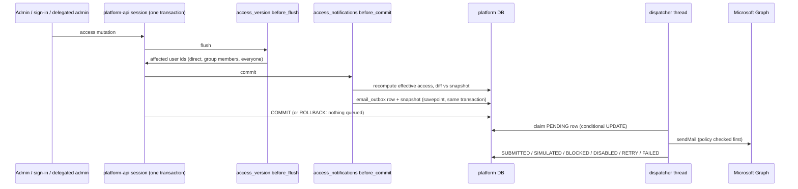

# DijiOne email notifications — access notifications and the shared foundation

> Status: implemented locally on `feat/email-notifications` (not deployed). Builds on
> [`email-architecture.md`](email-architecture.md): **shared code, never shared runtime
> ownership**. No central `notification-api`, no new Azure resource.

## What exists

| Piece | Where | Owner |
|---|---|---|
| Subject convention `[Application Name] \| Purpose` | `packages/mail-client-py/mail_client_py/subject.py` (`format_subject`) | shared code |
| Escaped, branded email layout (HTML + text) | `packages/mail-client-py/mail_client_py/templates.py` (`render_email`) | shared code |
| Bounded exponential backoff, retryable outcomes | `packages/mail-client-py/mail_client_py/retry.py` | shared code |
| Transport / policy / `MailClient` (unchanged) | `packages/mail-client-py` | shared code |
| Access-change detection + transactional outbox | `apps/platform-api/app/services/access_notifications.py` | platform-api |
| Dispatcher (in-process, replica-safe) | `apps/platform-api/app/services/email_dispatcher.py` | platform-api |
| Admin API | `/api/platform/admin/notifications/*` (proxied as `/api/admin/notifications/*` by admin-api) | platform-api |
| Admin UI | Admin Center > **Notifications** (`apps/admin-web/src/app/notifications`) | admin-web |
| Tables | `email_outbox`, `user_access_snapshots`, `notification_event_settings`, `email_test_recipients` (migration `t2u4w6y8a0c2`) | platform DB |

Birthday's email is untouched: it keeps its own identity, config, allowlist table and outbox
semantics. It may adopt `format_subject`/`render_email` later, on its own release schedule.

## Sender identity

- Mailbox `appassistant@dijitalteam.com`, display name **Diji Apps Notify**, resolved by
  Exchange from the mailbox. Nothing sets a display name per message (Graph payload has no
  `from`; `MailClient.send` has no sender parameter).
- platform-api sends with **its own** system-assigned managed identity and **its own**
  Exchange RBAC-for-Applications assignment scoped to that mailbox only (runbook below). It
  never uses birthday-api's identity.

## Events

| Event | Subject | When |
|---|---|---|
| `access.welcome` | `[DijiOne] \| Access Available` | A person's first application access appears (including default DijiAtWork access at first sign-in). Lists every application. |
| `access.granted` | `[DijiOne] \| Access Granted` | One or more applications gained, nothing lost or changed. |
| `access.revoked` | `[DijiOne] \| Access Revoked` | One or more applications lost, nothing gained or changed. |
| `access.updated` | `[DijiOne] \| Application Access Updated` | Effective permissions changed in an application, or a mix of gains/losses. |
| `account.deactivated` | `[DijiOne] \| Account Deactivated` | Active → inactive. One email, not one per application. |

Each can be switched off in Admin > Notifications > Events (absent setting = on).

## How a change becomes an email

- **Effective access, not rows.** Detection reuses the `access_version` listener, which
  already knows every model that can alter access. At commit, each affected person's access is
  recomputed with `AuthorizationService` (direct, group, default/baseline, appointments,
  suspensions, disabled applications) and compared with `user_access_snapshots`. No
  difference, no email — a duplicate grant, a group that adds nothing new, or a touched row
  queue nothing. Group operations email only members whose effective access changed.
- **Default access.** A permission change inside access that is default-only before and after
  (DijiAtWork's attendance permissions arriving when an employee record is matched) is not an
  email. First access produces one welcome listing everything.
- **Transactional.** The outbox row and snapshot are written in a savepoint inside the same
  transaction as the change. Rolled back → nothing queued. Any notification error is logged and
  swallowed; it never fails or reverts the change and never blocks a sign-in.
- **Deduplication.** `dedupe_key = access:<user>:v<snapshot version>` is unique. A concurrent
  transaction that loses the race queues nothing; its change is included in the next diff.
- **Folding.** Rows wait `ACCESS_EMAIL_DELAY_SECONDS` (default 60). A further change in that
  window supersedes the unsent row with one email for the net change; a change undone in time
  sends nothing.
- **Platform-wide changes are silent.** Enabling or disabling a whole application, or editing
  the role, permission or default-access catalog, emails nobody: every person's snapshot is
  realigned silently, so the change is never reported later either. A waiting (unsent) email
  is kept, and its starting point is rebased so a folded follow-up cannot mention the global
  change. People whose own assignment, group membership, delegation or account changed (even
  in the same commit) are emailed as usual. Consequence: a default application rolled out by
  catalog change produces no welcome/granted email.
- **Existing people.** Anyone without a snapshot gets a silent baseline (the dispatcher runs
  `backfill` at start; also `python -m app.services.access_notifications backfill`). No email
  is ever sent about the past.
- **Changes made outside the ORM.** A release can change effective access without any ORM
  write (a data migration editing the role catalog, or a code constant such as default-access
  permissions). At start the dispatcher also runs `rebaseline_snapshots`, which silently
  realigns every stored snapshot with current access (no email, version unchanged, optimistic
  `updated_at` check so a concurrent real change is never overwritten). Without it, the next
  unrelated change for that person would report the release change as "updated".
- **View-as.** Read-only impersonation tokens are refused by every mutating and every
  notification-admin endpoint (`deps.get_current_user`), so they can neither change access nor
  trigger, retry or configure email (tests in `test_access_notifications.py`).

## Delivery

- In-process `DispatcherThread` (every `EMAIL_DISPATCH_INTERVAL_SECONDS`, default 30) plus
  Admin > Notifications > **Process now**. No Container Apps Job, no queue, no added cost.
- Replica-safe claim: `UPDATE ... SET status='SENDING' WHERE id=? AND status IN ('PENDING','RETRY')`.
  A claim older than `EMAIL_CLAIM_LEASE_SECONDS` (300) is released. Delivery is at-least-once
  (a crash after Graph accepted but before the row was marked can resend once).
- Retries: transport `FAILED` only, `EMAIL_MAX_ATTEMPTS` (5) with backoff
  `EMAIL_RETRY_BASE_SECONDS * 2^(n-1)` capped at `EMAIL_RETRY_CAP_SECONDS`. Policy refusals
  (`BLOCKED`, `DISABLED`) are not retried automatically; an administrator can retry them after
  fixing configuration.
- Statuses: `PENDING`, `SENDING`, `RETRY`, `SUBMITTED` (Graph 202 — **accepted, not a delivery
  confirmation**), `SIMULATED`, `FAILED`, `BLOCKED`, `DISABLED`, `SUPERSEDED`, `SKIPPED`.
- Recorded per row: correlation id (also the Graph `client-request-id` context), attempts,
  timestamps, transport outcome, Graph request id, sanitized last error.
- Logs carry correlation id and status only — no address, subject or body.

## Content and privacy

Emails contain: a greeting without a name, application display names, the kind of change, a
link to `PUBLIC_BASE_URL` (https only), and the standard footer. Never permission keys, roles,
client scopes, who made the change, or reasons. All text is HTML-escaped by `render_email`.

## Environments

| Environment | Transport | Policy (effective) | Result |
|---|---|---|---|
| Local / CI | `null` (default) | simulated | Rows become `SIMULATED`; nothing leaves the machine. |
| DEV | `graph` | `internal_allowlist` | Only Admin > Notifications test recipients receive mail; others `BLOCKED`. |
| UAT | `graph` | `internal_allowlist` | Same as DEV, own list, own identity. |
| PROD | `graph` | `production` | Real recipients. The app honours `production` only when `APP_ENV=prod`; anywhere else it is `disabled`. |

Until an environment's `platformMail*` Bicep parameters are set (each needs approval), it emits
no `MAIL_*` and runs the null transport. Settings: `apps/platform-api/.env.example`.

## Administration (Admin Center > Notifications)

- **Delivery history** — filter by application, event, status, recipient; details (error,
  attempts, correlation id); **Retry** for `FAILED`/`BLOCKED`/`DISABLED`/`SKIPPED`; **Process now**.
- **Events** — switch each event on/off.
- **Test recipients** — explicit individual addresses only (a whole `@domain` is refused, and a
  legacy `@domain` row is ignored by the dispatcher); used only by `internal_allowlist`.
- **Retry** refuses (409) an access email that no longer describes the person's current access
  (a newer access email exists, a granted application is gone, a revoked one is back, or a
  deactivated account is active again), so a retry never sends obsolete information.
- Permissions: dedicated `platform.admin.view_notifications` (history shows addresses) and
  `platform.admin.manage_notifications` (retry, process now, events, test recipients), added by
  migration `u3v5x7z9b1d3` to SUPER_ADMIN and PLATFORM_ADMIN only. Ordinary users and View-as
  sessions are refused. Retry, event and recipient changes are written to the audit log.

## Required Azure / Exchange configuration (not performed — each step needs approval)

1. Exchange (Exchange admin, per environment), against platform-api's **existing**
   system-assigned identity — the runbook in `email-architecture.md`:
   - check the identity has no tenant-wide Graph `Mail.Send` app role (stop if it does);
   - `New-ServicePrincipal -AppId <platform-api MI appId> -ObjectId <MI objectId> -DisplayName "DijiOne-Platform-<Env>-API-MI"`;
   - reuse the existing mailbox-only scope (`DijiApps-AppAssistant-Mailbox-Scope`, or create
     `DijiOne-Platform-MailSender-Scope` with `PrimarySmtpAddress -eq 'appassistant@dijitalteam.com'`);
   - `New-ManagementRoleAssignment -Name "DijiOne-Platform-<Env>-MailSend" -Role "Application Mail.Send" -App "DijiOne-Platform-<Env>-API-MI" -CustomResourceScope <scope>`;
   - `Test-ServicePrincipalAuthorization` → `InScope True` for the mailbox, `False` for another.
   The mailbox, its display name and birthday-api's assignments are not touched.
2. Bicep (per environment, after 1): in `main.<env>.bicepparam` set `platformMailTransport =
   'graph'`, `platformMailPolicy` (`internal_allowlist` DEV/UAT, `production` PROD) and
   `platformMailSharedMailbox = 'appassistant@dijitalteam.com'`. Optional: `PUBLIC_BASE_URL`
   is already set per environment for the email link.
3. Migration `t2u4w6y8a0c2` runs via the existing `migrate-platform-api` job.
4. DEV/UAT: add test recipients in Admin > Notifications before switching the transport on.

## Mail configuration drift guard

`deploy/mail-config-guard.sh` runs inside `deploy.sh` and `promote.sh` before the workload
deployment. It compares, read-only, the live `MAIL_*` env of birthday-api and platform-api
with what the param file will produce and stops on any difference (override only with
`ALLOW_MAIL_CONFIG_CHANGE=1` when that change is the approved intent). This closes the gap
where a full redeploy silently reset birthday-api's mail settings. It fails **closed**: any
`az` error other than "resource not found" (expired login, wrong subscription, throttling)
stops the deploy rather than being read as "nothing to compare". Only `az` stdout is
compared: stderr (for example the containerapp extension's `WARNING:` lines) is kept apart
and used only for the error message, and a malformed (multi-line) result also fails closed.
Each service is compared and reported on its own. Regression tests with a fake `az`:
`scripts/ci/mail-config-guard.test.js` (run by CI's `guard` job on every event).

## Adding another application later

An application that wants email (attendance summaries, TalentFlow reviews, Birthday reports)
follows `email-architecture.md`'s adoption checklist with its **own** identity, config, outbox
and allowlist, and uses `format_subject("<App>", "<Purpose>")` and `render_email(...)` from the
shared package. platform-api's outbox is not a shared queue for other services.

## Tests

- `packages/mail-client-py/tests/test_subject_templates_retry.py` — subject convention and
  injection, template escaping and link safety, backoff.
- `apps/platform-api/tests/test_access_notifications.py` — welcome / default access, grants,
  revocations, role changes through the admin API, groups, no-op changes, rollback,
  failure isolation (also at sign-in), folding, event switches, module disable, every
  dispatcher outcome, allowlist, PROD-only policy, retries/backoff, claims, escaping, admin API
  authorization, and View-as refusal.
