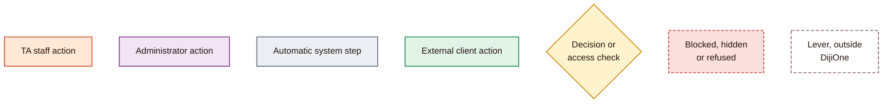

# DijiTalentFlow V1: Functional Workflow and User Guide

**Start here.** This guide explains how DijiTalentFlow V1 works from beginning to end: who does what, what happens automatically, what clients can and cannot see, and how to move through every screen. It is written for the application owner and for anyone preparing user acceptance testing (UAT).

| | |
|---|---|
| **Application** | DijiTalentFlow, a module of DijiOne, by Dijital Team |
| **Version described** | V1, release commit `0437a89` (PR #92), live in UAT and Production since 12 November 2026 |
| **How it was checked** | Every statement was checked against the V1 source code (the TalentFlow screens, the Talent and Recruitment services, the client portal and the Admin Center) on 13 November 2026. Nothing was run against a live environment while writing it |
| **What it is not** | Not a technical or deployment document. For those, see `docs/talent-flow/handover/` |

---

## DijiTalentFlow in one minute

1. **Lever is the source.** Recruitment happens in Lever. DijiTalentFlow only **reads** Lever and never changes anything there.
2. **A tag links a job to a client.** A Lever job posting belongs to a client only when Talent Acquisition (TA) gives it exactly one tag in the form `DTC - <Client Name>` that matches a known client exactly.
3. **Everything arrives automatically and hidden.** Every six hours DijiTalentFlow brings in the tagged postings as **Talent Requests**, and their candidates as **Candidates** and **Applications**. Every application starts **hidden** from the client.
4. **TA decides what the client sees.** TA staff review the candidates and tick **Client Visible** only for those they want to share.
5. **Clients use a link, not an account.** TA generates a time-limited, revocable **access link**. The client opens it in a separate, read-only **client portal** that shows only their own requests and the candidates shared with them.

```mermaid
%%{init: {"flowchart": {"wrappingWidth": 330}}}%%
flowchart LR
    P1(["① Job posting tagged<br/>in Lever by TA"]):::ext --> P2["② Automatic sync and<br/>client matching"]:::auto
    P2 --> P3["③ Requests and candidates<br/>created, all hidden"]:::auto
    P3 --> P4["④ TA reviews and<br/>shares candidates"]:::ta
    P4 --> P5["⑤ TA issues a client<br/>access link"]:::ta
    P5 --> P6(["⑥ Client views the<br/>read-only portal"]):::client

    classDef ta fill:#FFE8D6,stroke:#C9431D,stroke-width:1.5px,color:#24140F
    classDef auto fill:#ECEFF3,stroke:#5B6472,stroke-width:1.5px,color:#24140F
    classDef client fill:#E2F3E8,stroke:#138A4B,stroke-width:1.5px,color:#24140F
    classDef ext fill:#FFFFFF,stroke:#76584C,stroke-width:1.5px,stroke-dasharray:6 3,color:#24140F
```

---

## Recommended reading order

| # | Document | Read it to understand |
|---|---|---|
| 1 | [01 Master workflow](01-MASTER-WORKFLOW.md) | The complete lifecycle on one page, and exactly what clients can and cannot see |
| 2 | [02 TA workflow](02-TA-WORKFLOW.md) | The Talent Acquisition journey: sign-in, dashboard, portfolios, requests, candidates, sharing, interviews |
| 3 | [03 Admin workflow](03-ADMIN-WORKFLOW.md) | Activating staff, TalentFlow roles, client portfolio scope, and who manages external access |
| 4 | [04 Lever and candidate workflow](04-LEVER-AND-CANDIDATE-WORKFLOW.md) | How Lever data arrives, how postings are matched to clients, the candidate lifecycle, and the background jobs |
| 5 | [05 External client workflow](05-EXTERNAL-CLIENT-WORKFLOW.md) | Access links, the client portal, sharing and withdrawal |
| 6 | [06 Screen-by-screen guide](06-SCREEN-BY-SCREEN-GUIDE.md) | Every V1 screen: where it is, what it shows, what each button does, who can use it |
| 7 | [07 Guided walkthrough and UAT](07-GUIDED-WALKTHROUGH-AND-UAT.md) | A step-by-step tour to follow in the application, and the UAT checklist |

If you have only ten minutes, read [01](01-MASTER-WORKFLOW.md) and then follow the read-only part of the walkthrough in [07](07-GUIDED-WALKTHROUGH-AND-UAT.md#part-b-guided-walkthrough).

---

## How to read the diagrams

All diagrams use the same colours and shapes.

| Symbol | Meaning |
|---|---|
| Orange box | Something a TA staff member does in DijiTalentFlow |
| Purple box | Something a DijiOne administrator does in the Admin Center |
| Grey box | Something DijiOne does by itself (scheduled jobs, automatic rules) |
| Green box | Something the external client contact does or sees in the portal |
| Yellow diamond | A decision, or a check DijiOne makes before allowing something |
| Red dashed box | An outcome where something stays hidden, is refused or is blocked |
| White dashed box | Work done in Lever, outside DijiOne |
| Rounded ends | Where a journey starts or finishes |
| ① ② ③ | Step numbers, explained in the text under each diagram |
| Solid arrow | The normal next step |
| Dotted arrow | An optional, occasional or background connection |

**Rendering:** the diagrams are standard Mermaid. They display in GitHub and in VS Code's Markdown preview, which needs a Mermaid preview extension; `vstirbu.vscode-mermaid-preview` is installed on the Mac. Every diagram was test-rendered with Mermaid 11.17 before publication.

---

## Who uses DijiTalentFlow

| Person | How they get in | What they can do in V1 |
|---|---|---|
| **DijiOne administrator** (Platform Admin or Super Admin) | Signs in with Microsoft, then opens the **Admin Center** | Activates new staff accounts, gives them a DijiTalentFlow role and decides which clients they can work on. See [03](03-ADMIN-WORKFLOW.md) |
| **TA Member** | Signs in with Microsoft; needs an active account and a DijiTalentFlow role | The full TA workspace for the clients in their scope: dashboards, portfolios, requests, candidates, sharing, interviews, posting matching and client access links |
| **TA Manager** | Same as TA Member | Everything a TA Member can do. Also receives an alert when a posting's Lever tag conflicts with a manual decision, and holds the "review request" permission (no V1 request ever needs it) |
| **Customer Success** | Same as TA Member | The same screens as a TA Member, plus the "review request" permission, which no V1 request uses |
| **Client contact** (outside Dijital Team) | **Has no DijiOne account.** Opens an access link sent by TA | A read-only view of their own organisation's requests, the candidates TA has shared, and those candidates' interviews. See [05](05-EXTERNAL-CLIENT-WORKFLOW.md) |

> **In V1, TA Member, TA Manager and Customer Success see the same screens and buttons.** The differences are notifications and the unused review permission. What really changes what a staff member sees is their **client scope** (all clients, or specific clients), set by an administrator.

A fourth TalentFlow role, **Talent Client**, still exists in the Admin Center. It gives an account a "Client Workspace" inside the staff application. **It is not how clients work in V1** (they use the portal), so do not assign it. See [Known V1 limitations](#known-v1-limitations).

---

## Feature status in V1

| Status | Meaning | Examples |
|---|---|---|
| **Available** | Works in V1 for the stated roles | Lever sync, client matching, Talent Requests, candidate pool, applications, sharing, access links, client portal, interviews, audit |
| **Role or scope restricted** | Works, but only for some users or clients | Admin Center (administrators only); every staff screen limited to the user's client scope; reopening a manually unmapped posting (all-clients staff only) |
| **Built but disabled or unused in V1** | The code exists, but V1 does not use it | Client-submitted requests and manual candidate creation (always refused); editing an application's stage, status or score (they come from Lever); Customer Success review; TA status changes (no screen); the Talent Client workspace; Lever webhooks |
| **Future (not built)** | Not in V1 | Client feedback or approvals in the portal; messages and documents in the portal; real file storage; email delivery of access links; automatic request-stage progression; alerting; a branded portal address; Module Admin |

---

## Actions that change data or grant access

The guide marks every action that does more than look:

| Marker | Meaning | Examples |
|---|---|---|
| ✏️ **Changes data** | Saves a change in DijiTalentFlow (never in Lever) | Update Stage, Add Candidate, Schedule Interview, interview status, messages, documents, posting Verify, Change, Unmap and Reopen |
| 🔑 **External access** | Changes what someone outside Dijital Team can see | Ticking **Client Visible**, generating, extending, regenerating or revoking an access link |
| 🔄 **Runs a sync** | Reads Lever and immediately updates requests, candidates and applications | The **Sync now** button |
| 🛡️ **Administration** | Changes who can sign in or what they can see | Activate or deactivate a user, change a role, change a client scope |

> **Production holds real client and candidate data.** Do the read-only steps anywhere. Do every marked step **only in UAT, and only with explicit approval.** **Sync now** also runs in UAT and DEV, where the scheduled reconcile is currently paused.

| Environment | Staff address | Use for |
|---|---|---|
| UAT | `https://dijione-uat.dijitalteam.com` | Acceptance testing, including approved changing steps |
| Production | `https://dijione.dijitalteam.com` | Read-only exploration only, unless a change is separately approved |

In both, DijiTalentFlow is at `/talent-flow` and the Admin Center is at `/admin`. Each environment has its own client portal address, which arrives inside the access link.

---

## Known V1 limitations

These came out of the code review for this guide. Some correct the engineering handover.

| # | Limitation | Effect for users | Where |
|---|---|---|---|
| L1 | **An application's stage, status and score cannot be edited in DijiTalentFlow.** They come from Lever and are marked "Synced from Lever". The handover's statement that "TA updates stage, status, score" is out of date | To move a candidate, change their stage in Lever; DijiTalentFlow follows at the next reconcile | [04](04-LEVER-AND-CANDIDATE-WORKFLOW.md#d-candidate-lifecycle) |
| L2 | **The client portal is view-only.** Clients cannot comment, approve, reject, message or upload | Client feedback still happens outside DijiOne (email, calls) | [05](05-EXTERNAL-CLIENT-WORKFLOW.md) |
| L3 | **No email is sent.** Access links are shown once on screen and must be copied and sent by TA personally | If the link is lost, use **Regenerate** | [05](05-EXTERNAL-CLIENT-WORKFLOW.md#e1-access-link-lifecycle) |
| L4 | **There is no screen to create a client.** A posting tagged with an unknown client name stays unmatched until a client record exists | The handover reports 30 such Production postings. Fixing them needs the tag corrected in Lever, or a technical change to add the client | [03](03-ADMIN-WORKFLOW.md#b4-clients-and-external-access-who-manages-what) |
| L5 | **Lever-created requests carry little detail.** Description, skills, seniority and notes are empty; engagement type always shows "Full time" and priority "Medium" | Overview tabs look sparse. This is expected, not a fault | [02](02-TA-WORKFLOW.md#a3-working-on-a-talent-request) |
| L6 | **A request's stage does not follow its candidates automatically.** It starts at Sourcing and moves only when TA uses **Update Stage** | Keep request stages current by hand; clients see them | [02](02-TA-WORKFLOW.md#a3-working-on-a-talent-request) |
| L7 | **Interviews are recorded in DijiTalentFlow only.** They are not read from Lever, and no calendar invite or email is sent | Interviews held in Lever do not appear unless TA records them here too | [02](02-TA-WORKFLOW.md#a4-scheduling-and-tracking-interviews) |
| L8 | **Messages and documents are internal only.** Documents store a file name and category; no file is uploaded. Both are reachable only from a request's tabs | Do not rely on them to reach the client | [06](06-SCREEN-BY-SCREEN-GUIDE.md#s14-talent-request-detail) |
| L9 | **Customer Success review is unused.** Lever-created requests are approved automatically, so the **Review Request** button never appears, and the dashboard's "Pending Customer Success Review" list is always empty | Nothing to test here in V1 | [02](02-TA-WORKFLOW.md#a2-daily-ta-journey) |
| L10 | **Candidate availability has no real source.** Every candidate shows "Available"; Industry and Account Manager are hidden for the same reason | Ignore the availability badge | [06](06-SCREEN-BY-SCREEN-GUIDE.md#s15-candidate-pool) |
| L11 | **Large lists load in full.** Candidate Pool, Applications and the **Add Candidate** picker load every record in scope (about 9,700 candidates and 11,700 applications in Production) | These screens can be slow. The Add Candidate list is long | [06](06-SCREEN-BY-SCREEN-GUIDE.md#s17-applications) |
| L12 | **Some actions apply at once, with no confirmation.** Changing an interview status, ticking **Client Visible** and **Revoke** take effect as soon as you click | Click deliberately | [06](06-SCREEN-BY-SCREEN-GUIDE.md) |
| L13 | **"Sync now" can time out on a cold start**, showing "Sync status unavailable" or "Could not start the sync" | Wait a minute and retry. Known open item 12 | [04](04-LEVER-AND-CANDIDATE-WORKFLOW.md#f-background-automation) |
| L14 | **Several Lever stage mappings are provisional.** SME Interview counts as Screening; Reference check and Offer Declined count as Offer; any unrecognised Lever stage counts as Sourcing | Confirm these business rules during UAT | [04](04-LEVER-AND-CANDIDATE-WORKFLOW.md#d2-lever-stage-to-dijitalentflow-stage) |
| L15 | **Access changes apply at the next sign-in.** Roles and client scope travel in the sign-in token, which lasts up to 12 hours | After changing someone's access, ask them to sign out and back in | [03](03-ADMIN-WORKFLOW.md#b1-giving-a-staff-member-access) |
| L16 | **The Talent Client role is still offered** in the Admin Center, although V1 clients use the portal | Do not assign it | [03](03-ADMIN-WORKFLOW.md#b2-roles-and-permissions) |
| L17 | **The client portal session belongs to one browser tab.** A new tab or window asks for the link again | Tell clients to keep using the link | [05](05-EXTERNAL-CLIENT-WORKFLOW.md#e2-what-happens-when-the-client-opens-the-link) |
| L18 | **The Admin Center Audit screen shows only the latest 200 events,** across all of DijiOne, with no module filter | Busy reconciles can push older TalentFlow events out of view | [06](06-SCREEN-BY-SCREEN-GUIDE.md#s8-audit) |
| L19 | **The access-link rate limit may be shared by all visitors** (open item 10), because it counts by network address behind the Azure entry point | Under heavy use, a valid link could be briefly throttled. It fails safe | [05](05-EXTERNAL-CLIENT-WORKFLOW.md) |
| L20 | **Handover correction:** a *Partial* reconcile is reported as a failure, so the job is marked Failed and retried once. The handover says it returns success | Background behaviour only | [04](04-LEVER-AND-CANDIDATE-WORKFLOW.md#f-background-automation) |
