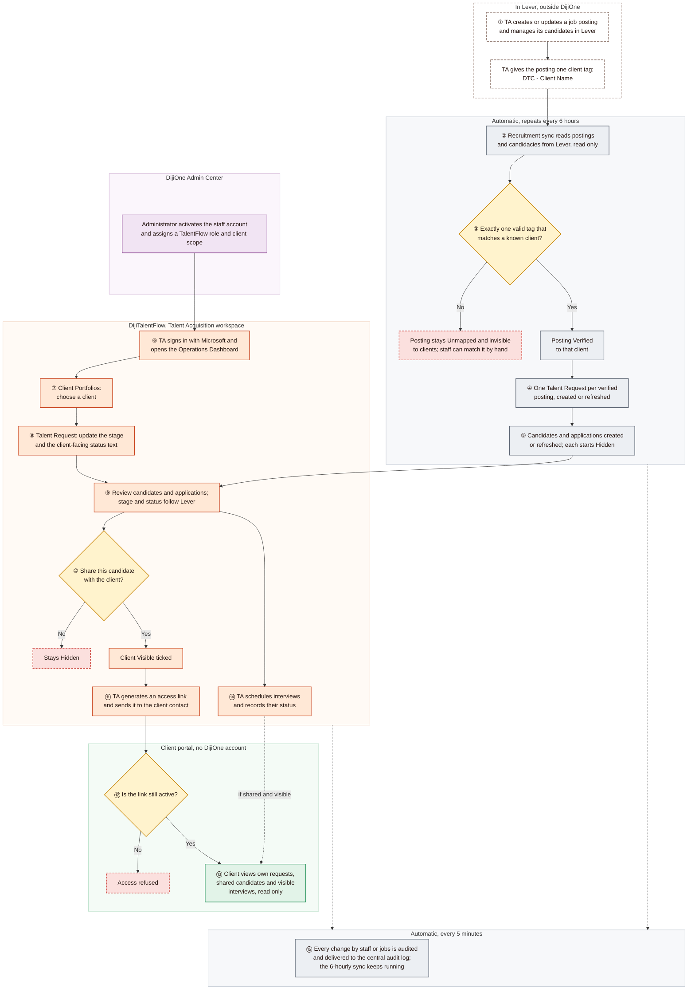

# 01: Master workflow, the complete DijiTalentFlow lifecycle

[Start](00-START-HERE.md) · next [02 TA workflow](02-TA-WORKFLOW.md)

This page shows the whole of DijiTalentFlow V1 on one diagram, from a job posting in Lever to a client viewing candidates in the portal. The numbered steps are explained underneath. Each later document zooms in on one part. Colours and shapes are explained in the [legend](00-START-HERE.md#how-to-read-the-diagrams).

---

## The lifecycle in six phases

```mermaid
%%{init: {"flowchart": {"wrappingWidth": 330}}}%%
flowchart LR
    P1(["Lever<br/>job posting and tag"]):::ext --> P2["Automatic sync<br/>every 6 hours"]:::auto
    P2 --> P3["Client matching<br/>Verified or Unmapped"]:::decision
    P3 --> P4["Requests, candidates and<br/>applications, all hidden"]:::auto
    P4 --> P5["TA review, sharing<br/>and access links"]:::ta
    P5 --> P6(["Client portal<br/>read only"]):::client

    classDef ta fill:#FFE8D6,stroke:#C9431D,stroke-width:1.5px,color:#24140F
    classDef auto fill:#ECEFF3,stroke:#5B6472,stroke-width:1.5px,color:#24140F
    classDef client fill:#E2F3E8,stroke:#138A4B,stroke-width:1.5px,color:#24140F
    classDef decision fill:#FFF3CD,stroke:#C78300,stroke-width:1.5px,color:#24140F
    classDef ext fill:#FFFFFF,stroke:#76584C,stroke-width:1.5px,stroke-dasharray:6 3,color:#24140F
```

---

## Master workflow diagram

---

## The lifecycle explained, step by step

| Step | What happens | Who starts it | Automatic or manual | Screen | Details |
|---|---|---|---|---|---|
| ① | A job posting is created in Lever and its candidates are managed there. TA gives the posting one tag, `DTC - <Client Name>` | TA, in Lever | Manual, outside DijiOne | Lever | [04 C1](04-LEVER-AND-CANDIDATE-WORKFLOW.md#c1-from-lever-posting-to-talent-request) |
| ② | DijiOne reads postings and their candidacies from Lever. It only reads; it never changes Lever | System | Automatic at 00:00, 06:00, 12:00 and 18:00 UTC, or when staff click **Sync now** | Operations Dashboard (sync panel) | [04 F](04-LEVER-AND-CANDIDATE-WORKFLOW.md#f-background-automation) |
| ③ | Fifteen minutes later, a reconcile matches each posting to a client. Only a single, well-formed tag that exactly matches an existing client name counts. Anything else leaves the posting **Unmapped** and invisible to clients | System | Automatic. Staff can also match a posting by hand | Recruitment Postings | [04 C1](04-LEVER-AND-CANDIDATE-WORKFLOW.md#c1-from-lever-posting-to-talent-request), [04 C2](04-LEVER-AND-CANDIDATE-WORKFLOW.md#c2-posting-matching-states-and-manual-actions) |
| ④ | Each verified posting becomes exactly one **Talent Request** for that client. It starts at stage *Sourcing* with status *In progress*. Its title and location stay in step with Lever | System | Automatic | All Requests, Client Portfolios | [04 C1](04-LEVER-AND-CANDIDATE-WORKFLOW.md#c1-from-lever-posting-to-talent-request) |
| ⑤ | Each Lever person becomes one **Candidate**, and each candidacy one **Application** on the request. Every application starts **Hidden**. Stage and status are refreshed from Lever at every reconcile | System | Automatic | Candidate Pool, Applications | [04 D](04-LEVER-AND-CANDIDATE-WORKFLOW.md#d-candidate-lifecycle) |
| ⑥ | A staff member signs in with Microsoft. An administrator must first activate the account and give it a TalentFlow role and client scope | Staff; administrator beforehand | Manual | DijiOne sign-in, Home, Operations Dashboard | [02 A1](02-TA-WORKFLOW.md#a1-sign-in-and-access-check), [03 B1](03-ADMIN-WORKFLOW.md#b1-giving-a-staff-member-access) |
| ⑦ | TA opens **Client Portfolios** to see each client's requests and how many candidates are shared | TA | Manual | Client Portfolios, Client detail | [02 A2](02-TA-WORKFLOW.md#a2-daily-ta-journey) |
| ⑧ | TA opens a request and keeps its **stage** and **client-facing status text** current. Lever never overwrites these | TA | Manual ✏️ | Talent Request detail | [02 A3](02-TA-WORKFLOW.md#a3-working-on-a-talent-request) |
| ⑨ | TA reviews the candidates on the request. Stage and status show "Synced from Lever" and cannot be edited here | TA | Manual (reading) | Candidates tab, Applications, Candidate Pool | [02 A3](02-TA-WORKFLOW.md#a3-working-on-a-talent-request) |
| ⑩ | TA decides which candidates the client should see by ticking **Client Visible** | TA | Manual 🔑 | Candidates tab, Applications | [05 E4](05-EXTERNAL-CLIENT-WORKFLOW.md#e4-sharing-and-withdrawing-candidates) |
| ⑪ | TA generates an **access link** for the client (1–90 days, default 14), copies it, and sends it personally. DijiOne sends no email | TA | Manual 🔑 | Client Access Links | [05 E1](05-EXTERNAL-CLIENT-WORKFLOW.md#e1-access-link-lifecycle) |
| ⑫ | The client opens the link. DijiOne checks that it exists, has not expired and has not been revoked, and re-checks this on every page | Client contact; then system | Automatic check | Portal access page | [05 E2](05-EXTERNAL-CLIENT-WORKFLOW.md#e2-what-happens-when-the-client-opens-the-link) |
| ⑬ | The client sees an overview, their requests, the shared candidates and visible interviews. **Read only:** no feedback, approval, messages or documents in V1 | Client contact | Manual (viewing) | Portal: Overview, Requests, Candidate, Interviews | [05 E3](05-EXTERNAL-CLIENT-WORKFLOW.md#e3-what-the-client-can-and-cannot-see) |
| ⑭ | TA records interviews on a request and updates their status. Interviews live only in DijiTalentFlow; Lever's interviews are not imported. Hiring outcomes (Hired, Rejected, Withdrawn) come from Lever | TA; outcomes from Lever | Manual ✏️ and automatic | Interviews tab, Interview Manager | [02 A4](02-TA-WORKFLOW.md#a4-scheduling-and-tracking-interviews), [04 D1](04-LEVER-AND-CANDIDATE-WORKFLOW.md#d1-one-candidate-many-applications) |
| ⑮ | Every important change (reconcile results, sharing, links, mapping decisions, interviews) is written to an audit trail and delivered to the central DijiOne audit log every 5 minutes. The 6-hourly sync keeps running | System | Automatic | Admin Center, Audit | [04 F](04-LEVER-AND-CANDIDATE-WORKFLOW.md#f-background-automation) |

---

## What happens when a posting cannot be matched

A posting is **Unmapped** when it has no `DTC` tag, more than one, a badly written one, or one naming a client DijiOne does not know.

- **Nothing about it reaches any client.** No Talent Request is created, and its candidates are not brought in.
- **TA can see it** on **Recruitment Postings**. The dashboard's sync panel shows how many postings "need client mapping review".
- **There are two ways to fix it:**
  1. Correct the tag in Lever. The next reconcile picks it up automatically.
  2. Staff choose the client by hand with **Verify manually** ✏️. A tag never overrides a manual decision.
- **A client record is never created from a tag.** If the client does not exist in DijiOne, the posting stays unmatched; V1 has [no screen to add clients](00-START-HERE.md#known-v1-limitations).

Full rules: [04 C1 and C2](04-LEVER-AND-CANDIDATE-WORKFLOW.md#c-lever-integration-workflow).

---

## What clients can and cannot see

| The client **can** see | The client **cannot** see |
|---|---|
| Their own organisation's Talent Requests, with title, stage, progress and the client-facing status text | Any other client's data: other links and addresses return "not found" |
| Candidates TA has marked **Client Visible**: name, professional title, skills, experience summary and stage | Hidden candidates, which is every candidate until TA shares it |
| Interviews for shared candidates, when the interview is marked visible: date, type, status and meeting link | Interviews for hidden candidates, or interviews marked not visible |
| Headline counts: active requests, candidates in process, interviews this week, offers in progress | Candidate email, phone, location, Lever source, internal notes, scores, TA status, Customer Success status, priority |
| | Messages, documents, Lever tags and posting mappings |
| | Anything at all once the link expires or is revoked; this applies from the next page they open |

The full decision path is in [05 E3](05-EXTERNAL-CLIENT-WORKFLOW.md#e3-what-the-client-can-and-cannot-see).

---

## Where checks and restrictions apply

| Check | Where | Effect |
|---|---|---|
| Account must be **active** | Every sign-in | New Microsoft sign-ins are created inactive and refused until an administrator activates them |
| A **TalentFlow role** is required | Opening DijiTalentFlow | Without one: "No DijiTalentFlow access" |
| **Client scope** | Every staff screen and action | Staff limited to specific clients see and act only on those clients, everywhere: lists, details, search, postings and access links |
| **Admin role** | Admin Center | Only Platform Admin or Super Admin. Changing someone's admin role needs Super Admin |
| **Exact tag match** | Reconcile | Anything other than one exact match fails closed (stays Unmapped) |
| **Manual decision wins** | Reconcile | A tag never overrides a posting matched or unmapped by hand; a conflict is flagged to TA Managers |
| **Lever is read-only** | Everywhere | No DijiOne action writes to Lever |
| **Hidden by default** | Every new application | Clients see a candidate only after TA ticks **Client Visible** |
| **Valid link** | Every portal page | Expired or revoked links stop working at the next page load |
| **Retired actions** | Creating requests or candidates by hand; editing application stage, status or score | Always refused in V1 |

Continue with [02 TA workflow](02-TA-WORKFLOW.md).
