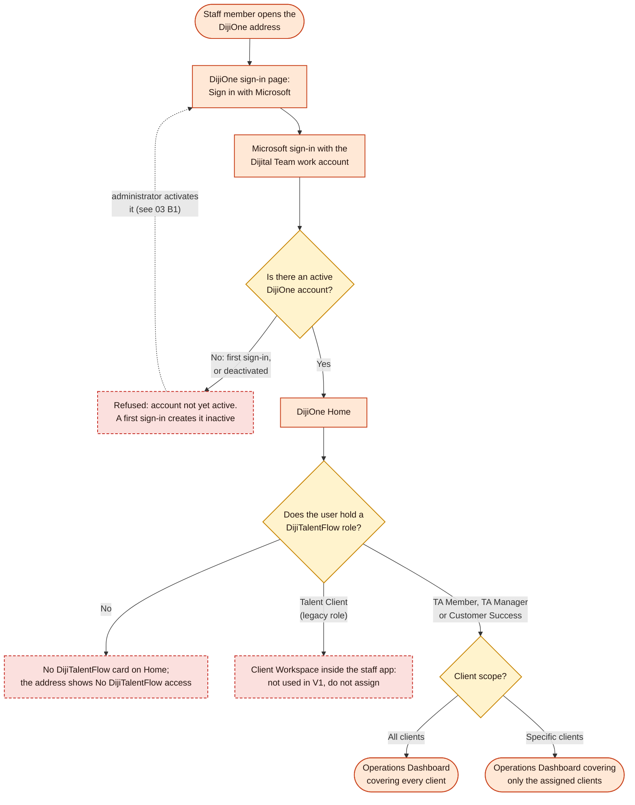
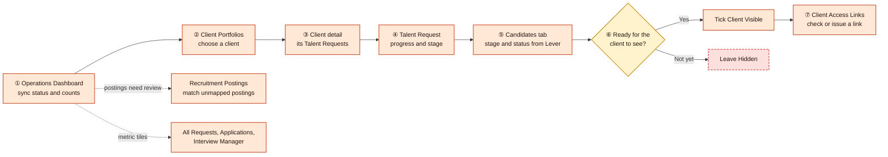
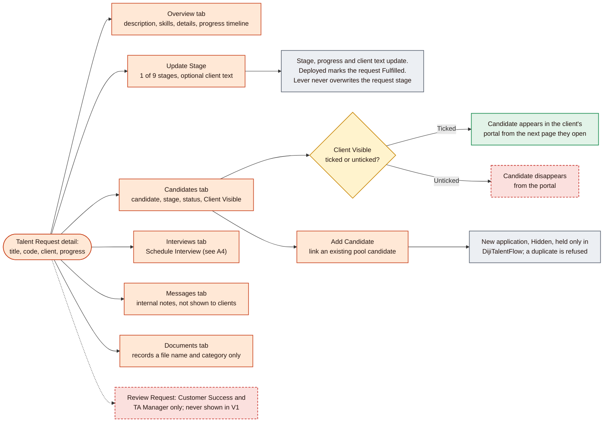
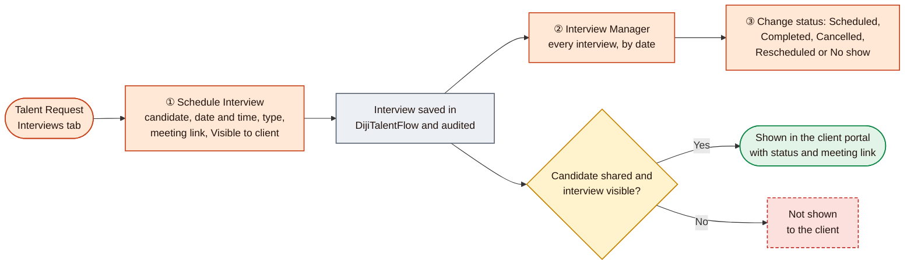

# 02: Talent Acquisition (TA) workflow

[Start](00-START-HERE.md) · prev [01 Master workflow](01-MASTER-WORKFLOW.md) · next [03 Admin workflow](03-ADMIN-WORKFLOW.md)

This document follows a TA staff member through DijiTalentFlow: signing in, the daily review journey, working on a single Talent Request, and recording interviews. It applies equally to **TA Members**, **TA Managers** and **Customer Success**; in V1 they share the same screens (see [roles](00-START-HERE.md#who-uses-dijitalentflow)). Colours follow the [legend](00-START-HERE.md#how-to-read-the-diagrams).

| Section | Diagram | Screens | UAT |
|---|---|---|---|
| [A1](#a1-sign-in-and-access-check) | Sign-in and access check | [S1](06-SCREEN-BY-SCREEN-GUIDE.md#s1-dijione-sign-in), [S2](06-SCREEN-BY-SCREEN-GUIDE.md#s2-dijione-home), [S9](06-SCREEN-BY-SCREEN-GUIDE.md#s9-no-dijitalentflow-access), [S10](06-SCREEN-BY-SCREEN-GUIDE.md#s10-operations-dashboard) | [U1](07-GUIDED-WALKTHROUGH-AND-UAT.md#u1-login-and-access-control) |
| [A2](#a2-daily-ta-journey) | Daily TA journey | [S10](06-SCREEN-BY-SCREEN-GUIDE.md#s10-operations-dashboard)–[S13](06-SCREEN-BY-SCREEN-GUIDE.md#s13-all-requests), [S17](06-SCREEN-BY-SCREEN-GUIDE.md#s17-applications) | [U2](07-GUIDED-WALKTHROUGH-AND-UAT.md#u2-dashboard-and-navigation), [U3](07-GUIDED-WALKTHROUGH-AND-UAT.md#u3-client-portfolios) |
| [A3](#a3-working-on-a-talent-request) | Working on a Talent Request | [S14](06-SCREEN-BY-SCREEN-GUIDE.md#s14-talent-request-detail) | [U5](07-GUIDED-WALKTHROUGH-AND-UAT.md#u5-talent-requests), [U6](07-GUIDED-WALKTHROUGH-AND-UAT.md#u6-candidates-and-applications), [U7](07-GUIDED-WALKTHROUGH-AND-UAT.md#u7-screening-and-stage-changes) |
| [A4](#a4-scheduling-and-tracking-interviews) | Scheduling and tracking interviews | [S14](06-SCREEN-BY-SCREEN-GUIDE.md#s14-talent-request-detail), [S18](06-SCREEN-BY-SCREEN-GUIDE.md#s18-interview-manager) | [U11](07-GUIDED-WALKTHROUGH-AND-UAT.md#u11-interviews-and-other-v1-workflows) |

Matching postings to clients is a TA task too; it is covered with the Lever workflow in [04 C2](04-LEVER-AND-CANDIDATE-WORKFLOW.md#c2-posting-matching-states-and-manual-actions). Issuing access links is covered in [05](05-EXTERNAL-CLIENT-WORKFLOW.md).

---

## A1. Sign-in and access check

| | |
|---|---|
| **Purpose** | Get a staff member into DijiTalentFlow with exactly the access an administrator has granted |
| **Who uses it** | TA Members, TA Managers, Customer Success |
| **How it starts** | Opening the DijiOne address (for UAT, `https://dijione-uat.dijitalteam.com`) and choosing **Sign in with Microsoft** |
| **Main actions** | Sign in with Microsoft → DijiOne Home → open the **DijiTalentFlow** card → you arrive on the **Operations Dashboard** |
| **Decision points** | (1) Is the account active? (2) Does it hold a DijiTalentFlow role? (3) Is the role limited to specific clients? |
| **Expected outcome** | The TA workspace opens, showing only the clients in the user's scope |
| **Restrictions and errors** | A first-ever sign-in creates the account **inactive** and shows *"Your account is not yet active in DijiOne. It has just been created — ask a platform administrator to activate it and assign access."* With no TalentFlow role there is no card on Home, and opening `/talent-flow` shows **No DijiTalentFlow access**. Role or scope changes apply after the user **signs out and back in**, because access travels in the sign-in token, which lasts up to 12 hours |
| **Screens** | [S1 Sign-in](06-SCREEN-BY-SCREEN-GUIDE.md#s1-dijione-sign-in) · [S2 Home](06-SCREEN-BY-SCREEN-GUIDE.md#s2-dijione-home) · [S9 No access](06-SCREEN-BY-SCREEN-GUIDE.md#s9-no-dijitalentflow-access) · [S10 Operations Dashboard](06-SCREEN-BY-SCREEN-GUIDE.md#s10-operations-dashboard) |

---

## A2. Daily TA journey

| | |
|---|---|
| **Purpose** | The everyday loop: check that Lever data is fresh, look at each client's open roles, review candidates, and decide what each client should see |
| **Who uses it** | All TA staff, within their client scope |
| **How it starts** | DijiTalentFlow always opens on the **Operations Dashboard** |
| **Main actions** | ① Read the **Recruitment data (Lever)** panel: *Last synced* time and status. ② Open **Client Portfolios** and pick a client (card or table view). ③ The client page lists its Talent Requests. ④ Open a request. ⑤ On the **Candidates** tab, review each candidate's stage and status (from Lever). ⑥ Tick **Client Visible** for candidates ready to share 🔑. ⑦ Make sure the client has a working access link ([05](05-EXTERNAL-CLIENT-WORKFLOW.md)) |
| **Shortcuts** | Every dashboard tile is a link: **Clients** → Client Portfolios; **Active Requests** → All Requests (active only); **Active Applications** → Applications; **Interviews Scheduled** and **Offers in Progress** link only when above zero. "*N postings need client mapping review →*" opens Recruitment Postings |
| **Decision points** | Is this candidate ready for the client? Nothing is shared until someone ticks the box |
| **Expected outcome** | Clients see up-to-date request stages and exactly the candidates TA chose |
| **Restrictions and errors** | Counts and lists cover only the user's client scope. The section **Needs Attention: Pending Customer Success Review** is always empty in V1, because Lever-created requests are approved automatically. **Sync now** is not a refresh button: it reads Lever and updates data 🔄, so use it only with approval. A cold start can show "Sync status unavailable"; wait and reload |
| **Screens** | [S10 Operations Dashboard](06-SCREEN-BY-SCREEN-GUIDE.md#s10-operations-dashboard) · [S11 Client Portfolios](06-SCREEN-BY-SCREEN-GUIDE.md#s11-client-portfolios) · [S12 Client detail](06-SCREEN-BY-SCREEN-GUIDE.md#s12-client-detail) · [S13 All Requests](06-SCREEN-BY-SCREEN-GUIDE.md#s13-all-requests) · [S14 Talent Request](06-SCREEN-BY-SCREEN-GUIDE.md#s14-talent-request-detail) · [S17 Applications](06-SCREEN-BY-SCREEN-GUIDE.md#s17-applications) · [S20 Client Access Links](06-SCREEN-BY-SCREEN-GUIDE.md#s20-client-access-links) |

---

## A3. Working on a Talent Request

| | |
|---|---|
| **Purpose** | Keep one client role (Talent Request) accurate, and curate which candidates the client sees |
| **Who uses it** | All TA staff, for requests of clients in their scope |
| **How it starts** | Open a request from Client Portfolios, All Requests, the dashboard or an application row. The page opens on **Overview**; it has five tabs: Overview, Candidates, Interviews, Messages, Documents |
| **Main actions** | **Update Stage** ✏️: pick one of the nine stages (Request submitted, Requirement confirmed, Sourcing, Screening, Client review, Interviews, Offer, Onboarding, Deployed). Optionally type the sentence the client will see; leave it blank to use the standard text (for example "Sourcing candidates", "Client interviews in progress"). **Client Visible** 🔑 on the Candidates tab. **Add Candidate** ✏️. **Schedule Interview** ✏️ ([A4](#a4-scheduling-and-tracking-interviews)). **Messages** ✏️ and **Documents** ✏️ |
| **Decision points** | Which stage is the role really at? Which candidates is the client ready to see? |
| **Expected outcome** | The client portal shows the right stage, progress and status sentence, and only the chosen candidates |
| **What you cannot do (by design)** | Change a **candidate's** stage, status or score: they show "Synced from Lever" and follow Lever at every reconcile. Create a request or a candidate by hand. Change the TA status (no screen). Edit the Overview details |
| **What to expect on Overview** | Requests created from Lever have an empty description, skills, seniority and notes; engagement shows **Full time** and priority **Medium** as defaults. Title and location follow Lever |
| **Restrictions and errors** | **The request stage does not move by itself** as candidates progress; update it by hand. Choosing **Deployed** also marks the request **Fulfilled**. Ticking **Client Visible** saves immediately, with no confirmation; if it fails, the box flips back and "Candidate sharing could not be updated" appears. **Add Candidate** lists the whole candidate pool, which is long in Production; the new application exists only in DijiTalentFlow (not in Lever), and its stage cannot be changed later. Messages and documents never reach the client in V1; a document records details only, and no file is uploaded |
| **Screens** | [S14 Talent Request detail](06-SCREEN-BY-SCREEN-GUIDE.md#s14-talent-request-detail) |

---

## A4. Scheduling and tracking interviews

| | |
|---|---|
| **Purpose** | Record interviews for candidates on a request, and let the client see the ones that concern candidates already shared with them |
| **Who uses it** | All TA staff |
| **How it starts** | On a Talent Request, open **Interviews** → **Schedule Interview**. (The Interview Manager has no schedule button; it lists interviews from every request.) |
| **Main actions** | ① Choose a candidate already linked to the request, the date and time, the type (Internal screen, **Client interview** by default, Technical, Final), an optional meeting link, and **Visible to client** (ticked by default) ✏️. ② Review all interviews by date in **Interview Manager**. ③ Change the status from the drop-down on any interview card ✏️ |
| **Decision points** | Should the client see this interview? Both conditions must hold: the candidate is **Client Visible**, and the interview is **Visible to client** |
| **Expected outcome** | The interview appears in the TA lists at once, and in the client portal if both conditions hold |
| **Restrictions and errors** | Interviews exist **only in DijiTalentFlow**. They are not read from Lever, and no invitation, email or calendar entry is sent. A status change saves **as soon as you pick it**, with no confirmation. There is no edit or delete; to correct a mistake, change its status (for example to Cancelled) and schedule a new one. The Interview Manager loads every interview in scope |
| **Screens** | [S14 Talent Request detail, Interviews tab](06-SCREEN-BY-SCREEN-GUIDE.md#s14-talent-request-detail) · [S18 Interview Manager](06-SCREEN-BY-SCREEN-GUIDE.md#s18-interview-manager) · [S28 Portal Interviews](06-SCREEN-BY-SCREEN-GUIDE.md#s28-portal-interviews) |

---

## What each TA role can do in V1

| Capability | TA Member | TA Manager | Customer Success |
|---|---|---|---|
| Operations Dashboard, Client Portfolios, All Requests, Candidate Pool, Applications, Interview Manager | ✓ | ✓ | ✓ |
| Update a request's stage and client-facing text ✏️ | ✓ | ✓ | ✓ |
| Tick or untick **Client Visible** 🔑 | ✓ | ✓ | ✓ |
| Add Candidate, schedule interviews, change interview status, messages, documents ✏️ | ✓ | ✓ | ✓ |
| Recruitment Postings: Verify manually, Change, Unmap ✏️ | ✓ | ✓ | ✓ |
| Recruitment Postings: **Reopen** a manually unmapped posting ✏️ | Only with **all clients** scope | Only with **all clients** scope | Only with **all clients** scope |
| Client Access Links: generate, extend, regenerate, revoke 🔑 | ✓ | ✓ | ✓ |
| **Sync now** 🔄 | ✓ | ✓ | ✓ |
| Review Request (Customer Success review) | – | Permission held; no V1 request needs it | Permission held; no V1 request needs it |
| Receives "posting mapping needs review" alerts for tag conflicts | – | ✓ | – |

**Client scope applies to every row.** Staff limited to specific clients see and act only on those clients. On Recruitment Postings they also see postings no client holds yet, so they can help match them; they never see another client's postings.

Continue with [03 Admin workflow](03-ADMIN-WORKFLOW.md).
