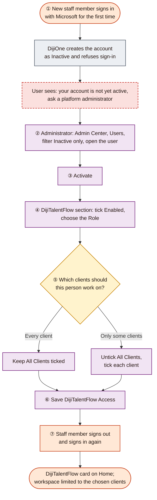
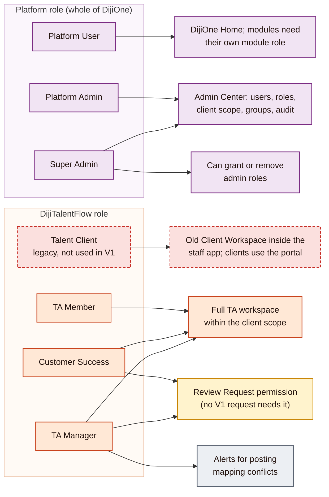
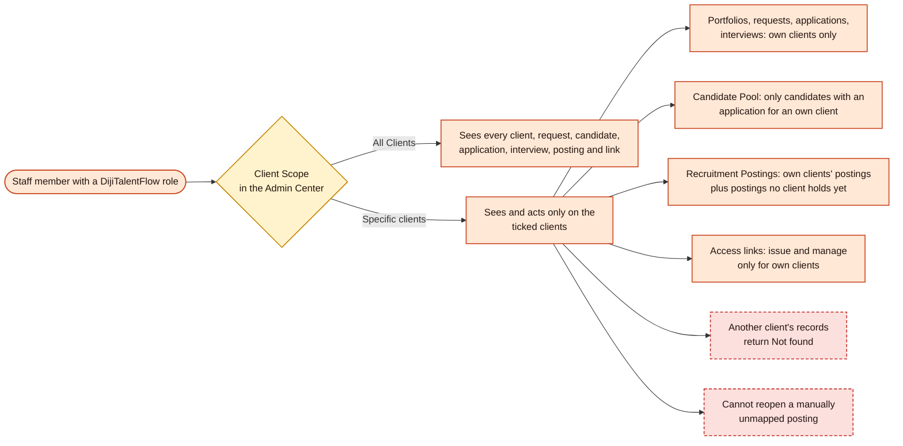
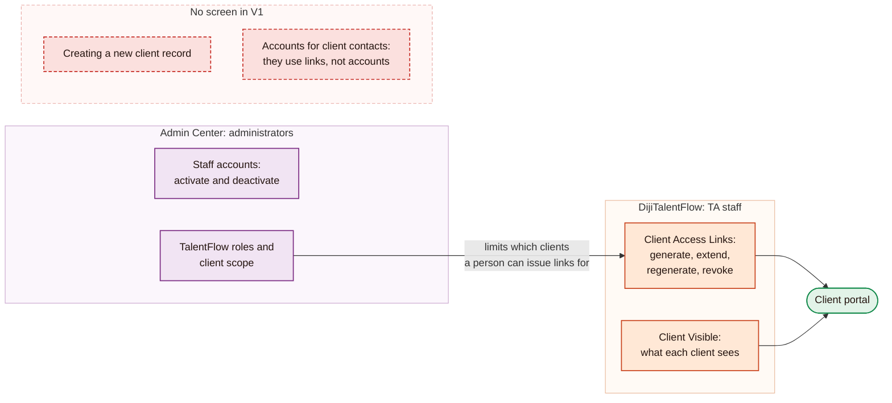
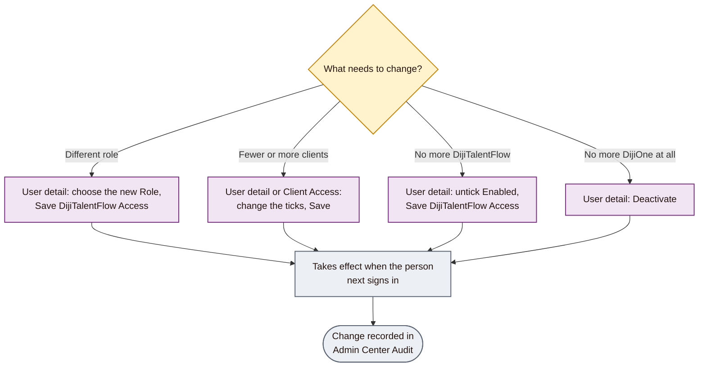

# 03: Administrator workflow

[Start](00-START-HERE.md) · prev [02 TA workflow](02-TA-WORKFLOW.md) · next [04 Lever and candidate workflow](04-LEVER-AND-CANDIDATE-WORKFLOW.md)

This document covers what a DijiOne administrator does so that staff can use DijiTalentFlow: activating accounts, assigning TalentFlow roles, limiting staff to particular clients, and changing or removing access. It also explains which parts of external client access are **not** managed in the Admin Center. Colours follow the [legend](00-START-HERE.md#how-to-read-the-diagrams).

The Admin Center is at `/admin` on the DijiOne address. It opens only for users whose platform role is **Platform Admin** or **Super Admin**.

| Section | Diagram | Screens | UAT |
|---|---|---|---|
| [B1](#b1-giving-a-staff-member-access) | Giving a staff member access | [S4](06-SCREEN-BY-SCREEN-GUIDE.md#s4-users), [S5](06-SCREEN-BY-SCREEN-GUIDE.md#s5-user-detail) | [U1](07-GUIDED-WALKTHROUGH-AND-UAT.md#u1-login-and-access-control) |
| [B2](#b2-roles-and-permissions) | Roles and permissions | [S7](06-SCREEN-BY-SCREEN-GUIDE.md#s7-roles-permissions-and-guide) | [U1](07-GUIDED-WALKTHROUGH-AND-UAT.md#u1-login-and-access-control) |
| [B3](#b3-client-portfolio-scope) | Client portfolio scope | [S5](06-SCREEN-BY-SCREEN-GUIDE.md#s5-user-detail), [S6](06-SCREEN-BY-SCREEN-GUIDE.md#s6-client-access) | [U1](07-GUIDED-WALKTHROUGH-AND-UAT.md#u1-login-and-access-control), [U3](07-GUIDED-WALKTHROUGH-AND-UAT.md#u3-client-portfolios) |
| [B4](#b4-clients-and-external-access-who-manages-what) | Clients and external access: who manages what | [S20](06-SCREEN-BY-SCREEN-GUIDE.md#s20-client-access-links) | [U9](07-GUIDED-WALKTHROUGH-AND-UAT.md#u9-external-access-link-management) |
| [B5](#b5-changing-or-removing-access) | Changing or removing access | [S5](06-SCREEN-BY-SCREEN-GUIDE.md#s5-user-detail), [S8](06-SCREEN-BY-SCREEN-GUIDE.md#s8-audit) | [U1](07-GUIDED-WALKTHROUGH-AND-UAT.md#u1-login-and-access-control) |

> Every action in this document is marked 🛡️ **Administration**: it changes who can sign in or what they can see. In UAT, do these only with approval. In Production, only as an agreed change.

---

## B1. Giving a staff member access

| | |
|---|---|
| **Purpose** | Turn a Microsoft sign-in into a working DijiTalentFlow account with the right role and client scope |
| **Who uses it** | Platform Admin or Super Admin |
| **How it starts** | The person signs in once, which creates their account **inactive**. An administrator can then find them under **Users** with the filter **Inactive only** |
| **Main actions** | ② Admin Center → **Users** → search or filter → open the user. ③ **Activate** 🛡️. ④ In the **DijiTalentFlow** access section, tick **Enabled** and pick a **Role** (TA Member, TA Manager or Customer Success). ⑤ Set **Client Scope**: keep **All Clients**, or untick it and tick specific clients. ⑥ **Save DijiTalentFlow Access** 🛡️. ⑦ Ask the person to sign out and back in |
| **Decision points** | Which role? ([B2](#b2-roles-and-permissions)) All clients or a portfolio? ([B3](#b3-client-portfolio-scope)) |
| **Expected outcome** | On their next sign-in the person sees the DijiTalentFlow card on DijiOne Home, and only their clients' data inside it |
| **Restrictions and errors** | **Activate** and the **Platform Role** drop-down save immediately. The DijiTalentFlow section needs **Save**. Granting or removing **Platform Admin** or **Super Admin** needs a Super Admin. Changes reach the person only after they sign in again; a sign-in lasts up to 12 hours. An existing DijiOne account is never linked to a Microsoft sign-in by email address alone |
| **Alternative** | Access can also come from an **access group** that carries a DijiTalentFlow role (**Groups**, or **Add to group…** on the user). Home and DijiTalentFlow honour both. This guide uses direct assignment because it is easier to check |
| **Screens** | [S3 Admin Center dashboard](06-SCREEN-BY-SCREEN-GUIDE.md#s3-admin-center-dashboard) · [S4 Users](06-SCREEN-BY-SCREEN-GUIDE.md#s4-users) · [S5 User detail](06-SCREEN-BY-SCREEN-GUIDE.md#s5-user-detail) |

---

## B2. Roles and permissions

A person has **one platform role** (for DijiOne as a whole) and, separately, **at most one role per module**. Admin rights do not include DijiTalentFlow access; an administrator who also works in DijiTalentFlow needs a TalentFlow role as well.

**DijiTalentFlow permissions, in plain language**

| Permission (as listed in Admin Center → Permissions) | TA Member | Customer Success | TA Manager | Used in V1? |
|---|---|---|---|---|
| Staff workspace, operations dashboard, client portfolios | ✓ | ✓ | ✓ | Yes |
| View all requests; update request stage and status | ✓ | ✓ | ✓ | Yes (stage only; there is no TA-status screen) |
| View candidate pool and applications; create an application; update an application | ✓ | ✓ | ✓ | Yes. "Update" now means **client visibility** only; stage, status and score come from Lever |
| View and manage interviews | ✓ | ✓ | ✓ | Yes |
| View and send messages; view and add documents | ✓ | ✓ | ✓ | Yes, staff side only |
| Review requests (Customer Success) | – | ✓ | ✓ | No: Lever-created requests are already approved |
| Create talent request; manage candidates | – | – | – | **Retired:** no role has them, and the screens refuse |

The **Talent Client** role holds "own organisation" versions of these permissions for an older design in which clients had DijiOne accounts. **In V1 clients use access links and the portal instead. Do not assign Talent Client.**

| | |
|---|---|
| **Purpose** | Know which role to give each person |
| **Who uses it** | Administrators, when assigning access |
| **How it starts** | Admin Center → **Roles**, **Permissions** or **Guide & Access Model** (all read-only reference pages) |
| **Decision points** | In practice, choose **TA Member** for most staff and **TA Manager** for whoever should receive mapping-conflict alerts. The real difference between users is their **client scope** |
| **Expected outcome** | Each person has one platform role and one TalentFlow role |
| **Restrictions and errors** | Roles cannot be created or edited in V1; the Roles and Permissions pages are for reference |
| **Screens** | [S7 Roles, Permissions and Guide](06-SCREEN-BY-SCREEN-GUIDE.md#s7-roles-permissions-and-guide) |

---

## B3. Client portfolio scope

| | |
|---|---|
| **Purpose** | Let some staff work only on particular clients (a portfolio) |
| **Who uses it** | Administrators set it; staff experience it |
| **How it starts** | User detail → DijiTalentFlow section → **Client Scope**. Or **Client Access**, which lists every TA and Customer Success assignment and lets you edit each scope in one place |
| **Main actions** | Keep **All Clients**, or untick it and tick clients → **Save** 🛡️ |
| **Decision points** | Should this person see every client, or only some? |
| **Expected outcome** | Every list, count, search, detail page and action in DijiTalentFlow is limited to the chosen clients. This is enforced by the server, not just hidden on screen |
| **Restrictions and errors** | A staff member limited to clients cannot see another client's records, even by typing an address; they get "not found". They also cannot reopen a manually unmapped posting, because it no longer belongs to any client |
| **Screens** | [S5 User detail](06-SCREEN-BY-SCREEN-GUIDE.md#s5-user-detail) · [S6 Client Access](06-SCREEN-BY-SCREEN-GUIDE.md#s6-client-access) · [S11 Client Portfolios](06-SCREEN-BY-SCREEN-GUIDE.md#s11-client-portfolios) |

---

## B4. Clients and external access: who manages what

| | |
|---|---|
| **Purpose** | Make clear who controls external access, because it is **not** in the Admin Center |
| **Who uses it** | Administrators and TA staff |
| **Key points** | **External access is managed by TA staff in DijiTalentFlow**, on **Client Access Links**, not by administrators. The administrator's part is indirect: a staff member can issue links only for clients in their scope. **Clients are not created in the Admin Center.** The client list comes from DijiOne's central client records, and V1 has no screen to add one. A Lever tag naming an unknown client therefore stays unmatched until a client record is added by a technical change, or the tag is corrected in Lever ([04 C1](04-LEVER-AND-CANDIDATE-WORKFLOW.md#c1-from-lever-posting-to-talent-request)). **Client contacts never get DijiOne accounts in V1** |
| **Expected outcome** | Administrators control staff access; TA controls client access |
| **Restrictions and errors** | The **Client Access** page in the Admin Center is about **staff** portfolio scope, despite its name. It does not manage client links |
| **Screens** | [S6 Client Access](06-SCREEN-BY-SCREEN-GUIDE.md#s6-client-access) · [S20 Client Access Links](06-SCREEN-BY-SCREEN-GUIDE.md#s20-client-access-links) |

---

## B5. Changing or removing access

| | |
|---|---|
| **Purpose** | Adjust or withdraw a staff member's access |
| **Who uses it** | Administrators |
| **Main actions** | Change role, change client scope, untick **Enabled**, or **Deactivate** 🛡️ |
| **Expected outcome** | The new access applies from the person's next sign-in. Every change is recorded in **Audit**, with the actor, time and before-and-after details |
| **Restrictions and errors** | The person's current sign-in token stays valid for up to 12 hours. Treat any change, including deactivation, as taking effect at the next sign-in, and check this during UAT ([U1](07-GUIDED-WALKTHROUGH-AND-UAT.md#u1-login-and-access-control)). Removing a staff member's access does **not** revoke access links they issued; links belong to the client and must be revoked on **Client Access Links** |
| **Screens** | [S5 User detail](06-SCREEN-BY-SCREEN-GUIDE.md#s5-user-detail) · [S6 Client Access](06-SCREEN-BY-SCREEN-GUIDE.md#s6-client-access) · [S8 Audit](06-SCREEN-BY-SCREEN-GUIDE.md#s8-audit) |

Continue with [04 Lever and candidate workflow](04-LEVER-AND-CANDIDATE-WORKFLOW.md).
