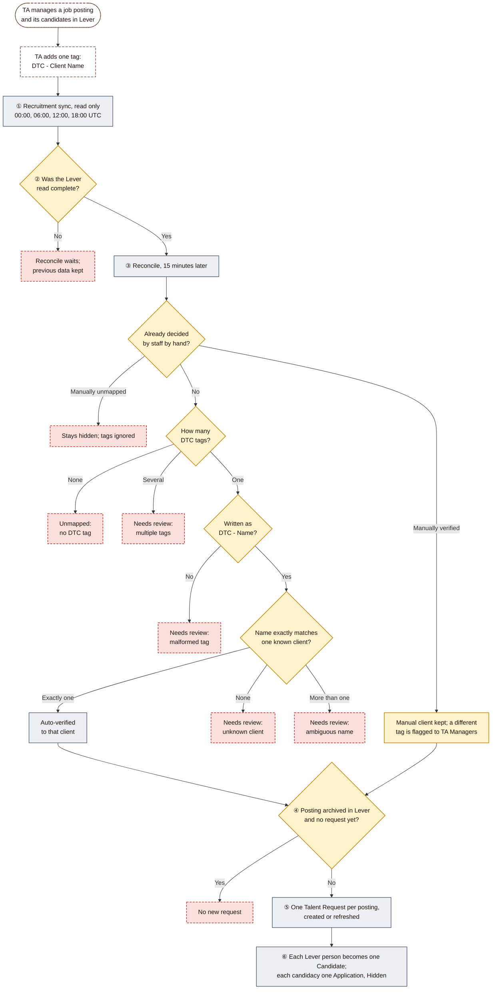
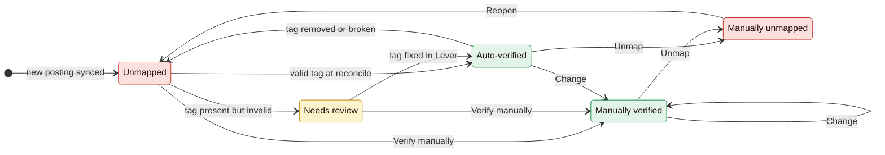
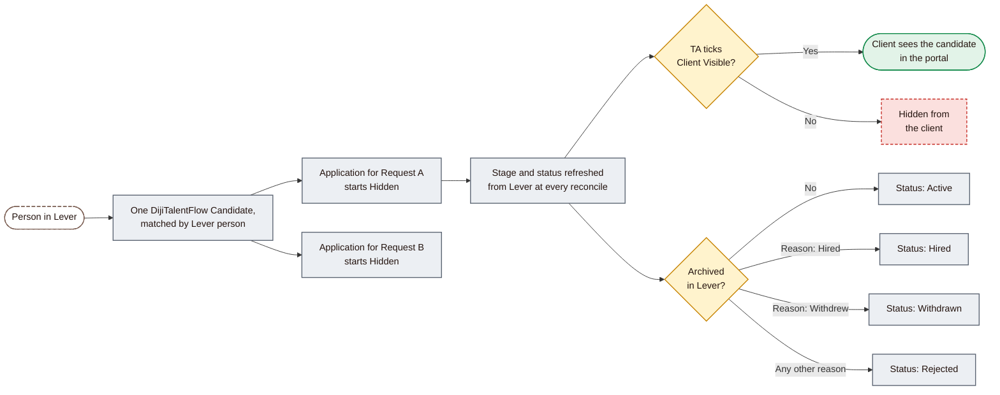
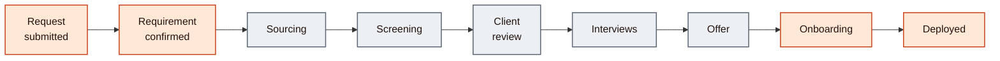
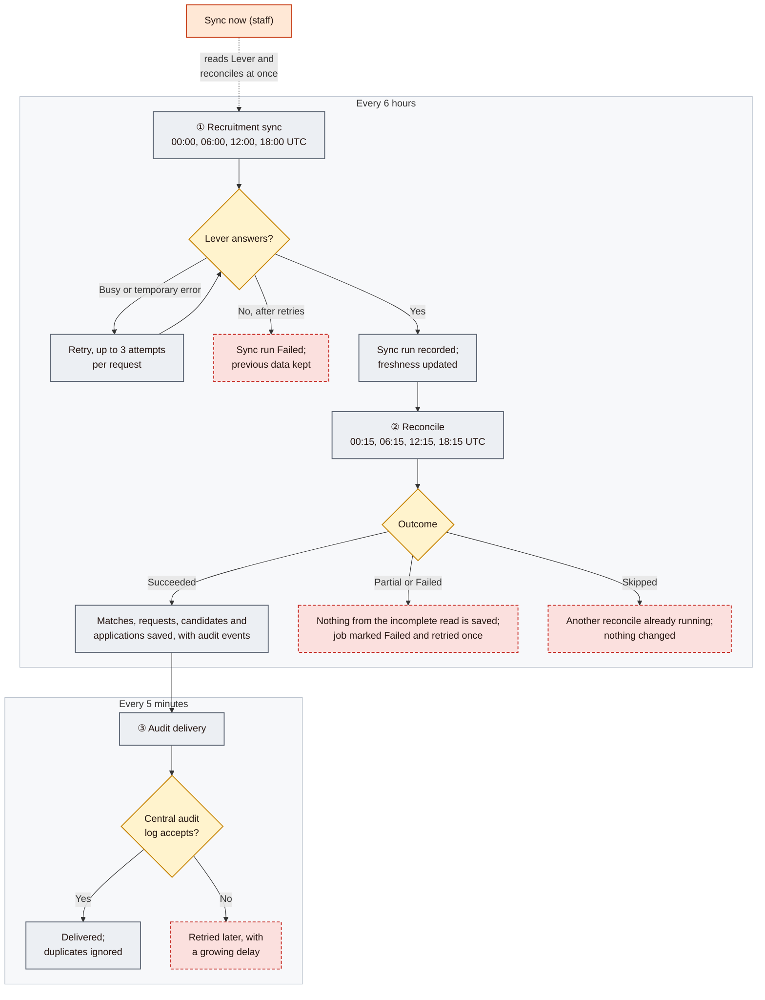

# 04: Lever integration, candidate lifecycle and background automation

[Start](00-START-HERE.md) · prev [03 Admin workflow](03-ADMIN-WORKFLOW.md) · next [05 External client workflow](05-EXTERNAL-CLIENT-WORKFLOW.md)

This document explains how recruitment data travels from Lever into DijiTalentFlow, how a posting is matched to a client, how candidates and applications are created and kept up to date, and which jobs run in the background. Colours follow the [legend](00-START-HERE.md#how-to-read-the-diagrams).

> **Lever is read-only.** DijiTalentFlow never creates, changes or deletes anything in Lever. Every change described here happens inside DijiOne.

| Section | Diagram | Screens | UAT |
|---|---|---|---|
| [C1](#c1-from-lever-posting-to-talent-request) | From Lever posting to Talent Request | [S19](06-SCREEN-BY-SCREEN-GUIDE.md#s19-recruitment-postings), [S13](06-SCREEN-BY-SCREEN-GUIDE.md#s13-all-requests) | [U4](07-GUIDED-WALKTHROUGH-AND-UAT.md#u4-job-postings-and-client-mapping) |
| [C2](#c2-posting-matching-states-and-manual-actions) | Posting matching states and manual actions | [S19](06-SCREEN-BY-SCREEN-GUIDE.md#s19-recruitment-postings) | [U4](07-GUIDED-WALKTHROUGH-AND-UAT.md#u4-job-postings-and-client-mapping) |
| [D1](#d1-one-candidate-many-applications) | One candidate, many applications | [S15](06-SCREEN-BY-SCREEN-GUIDE.md#s15-candidate-pool)–[S17](06-SCREEN-BY-SCREEN-GUIDE.md#s17-applications) | [U6](07-GUIDED-WALKTHROUGH-AND-UAT.md#u6-candidates-and-applications) |
| [D2](#d2-lever-stage-to-dijitalentflow-stage) | Lever stage to DijiTalentFlow stage | [S14](06-SCREEN-BY-SCREEN-GUIDE.md#s14-talent-request-detail) | [U7](07-GUIDED-WALKTHROUGH-AND-UAT.md#u7-screening-and-stage-changes) |
| [F](#f-background-automation) | Background automation | [S10](06-SCREEN-BY-SCREEN-GUIDE.md#s10-operations-dashboard), [S8](06-SCREEN-BY-SCREEN-GUIDE.md#s8-audit) | [U2](07-GUIDED-WALKTHROUGH-AND-UAT.md#u2-dashboard-and-navigation) |

---

## C. Lever integration workflow

### C1. From Lever posting to Talent Request

| | |
|---|---|
| **Purpose** | Bring Lever postings and candidates into DijiTalentFlow and decide, safely, which client each posting belongs to |
| **Who uses it** | Runs by itself. TA influences it through the tag in Lever, and through manual matching on Recruitment Postings |
| **How it starts** | The schedule (every 6 hours), or a staff member's **Sync now** 🔄 |
| **Main steps** | ① Read postings and candidacies from Lever. ② Continue only if the read was complete. ③ Match each posting to a client. ④ Skip creating new requests for archived postings. ⑤ Create or refresh one Talent Request per matched posting. ⑥ Create or refresh candidates and applications |
| **The tag rule** | Exactly one tag of the form `DTC - <Client Name>`. "DTC" can be in any case and spaces around the dash are allowed. The name must match an existing client's name **exactly**; there is no "close enough". A tag never creates a client |
| **Decision points** | No tag, several tags, a badly written tag, or an unknown or ambiguous name all **fail closed**: the posting stays Unmapped and nothing reaches any client. A manual staff decision always beats the tag |
| **What a new request looks like** | Code `SR-00001` style; stage **Sourcing**; status **In progress**; Customer Success **Approved**; TA status **ATS linked**; standard client text "Sourcing candidates". Title and location come from Lever and are refreshed at every reconcile. Description, skills, seniority and notes stay empty; engagement shows Full time and priority Medium |
| **What stays in step with Lever** | Request title and location. Candidate name, title and email (when Lever has them). Each application's stage, status and Lever archive reason |
| **What Lever never overwrites** | The request's stage and client-facing text, which TA sets. **Client Visible**. Interviews, messages and documents |
| **Expected outcome** | One request per matched posting, with no duplicates however often the sync runs. Every new application is hidden |
| **Restrictions and errors** | If a posting's tag is removed or broken, an auto-verified match reverts to **Unmapped** and the client loses access to that request at the next reconcile. If staff move a posting to a different client, the old request is closed (**Cancelled**), stays with the old client for staff records with everything un-shared, and a fresh request is created for the new client |
| **Screens** | [S10 Operations Dashboard (sync panel)](06-SCREEN-BY-SCREEN-GUIDE.md#s10-operations-dashboard) · [S19 Recruitment Postings](06-SCREEN-BY-SCREEN-GUIDE.md#s19-recruitment-postings) · [S13 All Requests](06-SCREEN-BY-SCREEN-GUIDE.md#s13-all-requests) |

### C2. Posting matching states and manual actions

Green states give the matched client access to the posting's request; red and yellow states give no client any access.

| Label on screen | Meaning | Client can see the request? | Who or what changes it |
|---|---|---|---|
| **Unmapped** | No `DTC` tag, or reopened by staff | No | Reconcile (valid tag), or staff **Verify manually** |
| **Needs review** | A tag exists but is unknown, ambiguous, malformed, or there are several. The reason appears under the label | No | TA fixes the tag in Lever, or staff **Verify manually** |
| **Auto-verified** | Matched from a valid tag | Yes, its client | Reconcile; staff **Change** or **Unmap** |
| **Manually verified** | Matched by a staff member; tags no longer override it | Yes, its client | Staff **Change** or **Unmap** |
| **Manually unmapped** | Deliberately removed by staff; tags are ignored | No | Staff **Reopen**, which needs all-clients scope |

| | |
|---|---|
| **Purpose** | Let TA correct or override the automatic matching |
| **Who uses it** | Any TA staff member for clients in their scope; **Reopen** needs all-clients scope |
| **How it starts** | Recruitment Postings, or the dashboard link "*N postings need client mapping review →*". Filter chips: **Recent / Active**, **Verified**, **Unmapped**, **Needs review**, **All** |
| **Main actions** | **Verify manually** → choose client → **Save** ✏️ 🔑. **Change** (on a verified posting) → choose a client → **Save** ✏️ 🔑. **Unmap** → confirm in "Remove client mapping?" ✏️ 🔑. **Reopen** ✏️ |
| **Expected outcome** | Verify or Change: the posting's request and candidates appear for that client after the next reconcile, all hidden. Unmap: the client loses access to that request at once, and the next sync will not re-verify it. Reopen: back to Unmapped, so the tag decides again at the next reconcile. None of these changes Lever |
| **Restrictions and errors** | Changing a posting to a different client closes the old client's request and starts a clean one for the new client, with nothing shared. Only clients in the user's scope appear in the client list |
| **Screens** | [S19 Recruitment Postings](06-SCREEN-BY-SCREEN-GUIDE.md#s19-recruitment-postings) |

---

## D. Candidate lifecycle

### D1. One candidate, many applications

| | |
|---|---|
| **Purpose** | Keep one master record per person, and one application per person per role, with Lever as the source of their progress |
| **Who uses it** | Created by the reconcile; reviewed by TA |
| **How it starts** | A candidacy in Lever against a matched posting. Candidacies on unmatched postings are **not** brought in |
| **Main actions** | TA reviews candidates on the request's **Candidates** tab, the **Candidate Pool** or **Applications**, and shares with **Client Visible** 🔑 |
| **Decision points** | Share or not; this is TA's only decision on an application in V1 |
| **Expected outcome** | The same person considered for two clients appears once in the pool with two applications. Each client sees, at most, its own application |
| **Final outcomes** | Come from Lever's archive reason: **Hired**, **Withdrawn**, or **Rejected** for any other reason. Not archived means **Active**. Short-listing and client review show as **stages**, not statuses |
| **Restrictions and errors** | Stage, status and score **cannot be edited** in DijiTalentFlow; to move a candidate, move them in Lever. If Lever has two candidacies for the same person and role, DijiTalentFlow keeps one: the most advanced, then the most recent. **Add Candidate** can link a pool candidate to a request by hand; that application exists only in DijiTalentFlow, and its stage cannot be changed later |
| **Screens** | [S14 Candidates tab](06-SCREEN-BY-SCREEN-GUIDE.md#s14-talent-request-detail) · [S15 Candidate Pool](06-SCREEN-BY-SCREEN-GUIDE.md#s15-candidate-pool) · [S16 Candidate detail](06-SCREEN-BY-SCREEN-GUIDE.md#s16-candidate-detail) · [S17 Applications](06-SCREEN-BY-SCREEN-GUIDE.md#s17-applications) |

### D2. Lever stage to DijiTalentFlow stage

DijiTalentFlow shows clients nine plain-language stages. Applications take theirs from Lever; a **request's** stage is set by TA.

Grey stages can come from Lever; orange stages have no Lever equivalent and are set only by TA, on the request.

| Lever stage | DijiTalentFlow stage | Note |
|---|---|---|
| New lead, Reached out, Responded, New applicant | Sourcing | |
| Recruiter Phone Screen, SparkHire Assessment Stage, TestGorilla Assessment, Predictive Talent Assessment | Screening | |
| SME Interview | Screening | **Provisional:** needs business confirmation |
| Presented to Customer | Client review | |
| Client Interview | Interviews | |
| Offer | Offer | |
| Reference check, Offer Declined | Offer | **Provisional:** needs business confirmation |
| Any other or new Lever stage | Sourcing | Fallback. Check during UAT that no real stage is falling into it |

---

## F. Background automation

| | |
|---|---|
| **Purpose** | Keep DijiTalentFlow current with Lever, and keep a reliable audit trail, without anyone pressing a button |
| **Who uses it** | Nobody directly. TA sees its result on the dashboard's **Recruitment data (Lever)** panel |
| **How it starts** | Three scheduled jobs: recruitment sync (every 6 hours on the hour), reconcile (15 minutes later), audit delivery (every 5 minutes) |
| **Current schedule state (13 Nov 2026)** | **Production:** all three running. **UAT and DEV:** sync and audit running; **the scheduled reconcile is paused**. So in UAT, new Lever data reaches requests and candidates only when someone clicks **Sync now** |
| **Decision points** | Was the Lever read complete? Did the reconcile succeed? Did the audit log accept the events? |
| **Failure and retry behaviour** | Temporary Lever errors are retried up to 3 times. A failed or incomplete run never deletes or half-applies data; the previous data stays. A failed or partial reconcile is marked Failed and retried once by the scheduler. Only one reconcile runs at a time. Audit events are stored with each change and re-sent until accepted; a duplicate is ignored |
| **What "Sync now" does** 🔄 | Starts a fresh Lever read **and immediately runs a reconcile**, then shows "Syncing recruitment data…". It checks every 3 seconds, for about 3 minutes, and then reports "Recruitment data updated · N records checked", "Sync incomplete…" or "Sync failed — please try again shortly." This **changes data** (new requests, candidates, applications and match decisions), even in environments where the scheduled reconcile is paused. The immediate reconcile uses the Lever data on hand when it starts, so the newest Lever changes may need the next run |
| **Expected outcome** | The dashboard panel reads *Up to date*, with a recent *Last synced* time |
| **Restrictions and errors** | The panel can briefly show *Sync status unavailable* or *Could not start the sync* while services wake up. Wait a minute and retry (known open item 12). The panel states the 6-hour schedule as configuration; it does not prove the jobs ran. There are no automatic alerts for failed jobs in V1 |
| **Where to see audit events** | Admin Center → **Audit** shows the latest 200 events across DijiOne, including DijiTalentFlow events once delivered ([S8](06-SCREEN-BY-SCREEN-GUIDE.md#s8-audit)) |
| **Screens** | [S10 Operations Dashboard](06-SCREEN-BY-SCREEN-GUIDE.md#s10-operations-dashboard) · [S8 Audit](06-SCREEN-BY-SCREEN-GUIDE.md#s8-audit) |

**Examples of audited events:** a request created from a posting; a posting verified, unmapped or reopened by hand; a candidate's visibility changed; an interview scheduled or its status changed; an access link created, opened, extended, regenerated or revoked; a sync requested; a request's stage changed.

Continue with [05 External client workflow](05-EXTERNAL-CLIENT-WORKFLOW.md).
