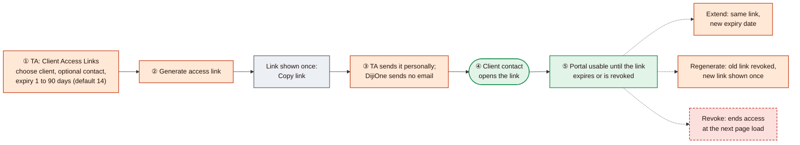
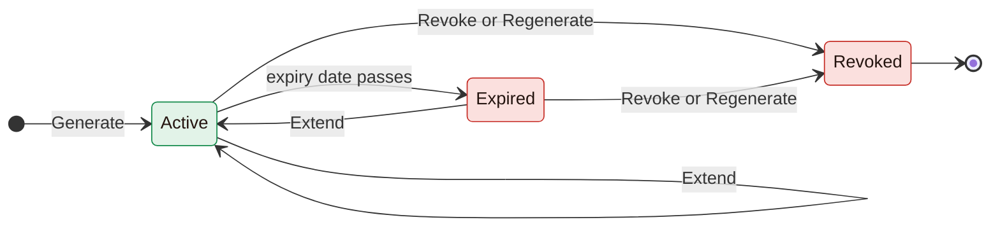
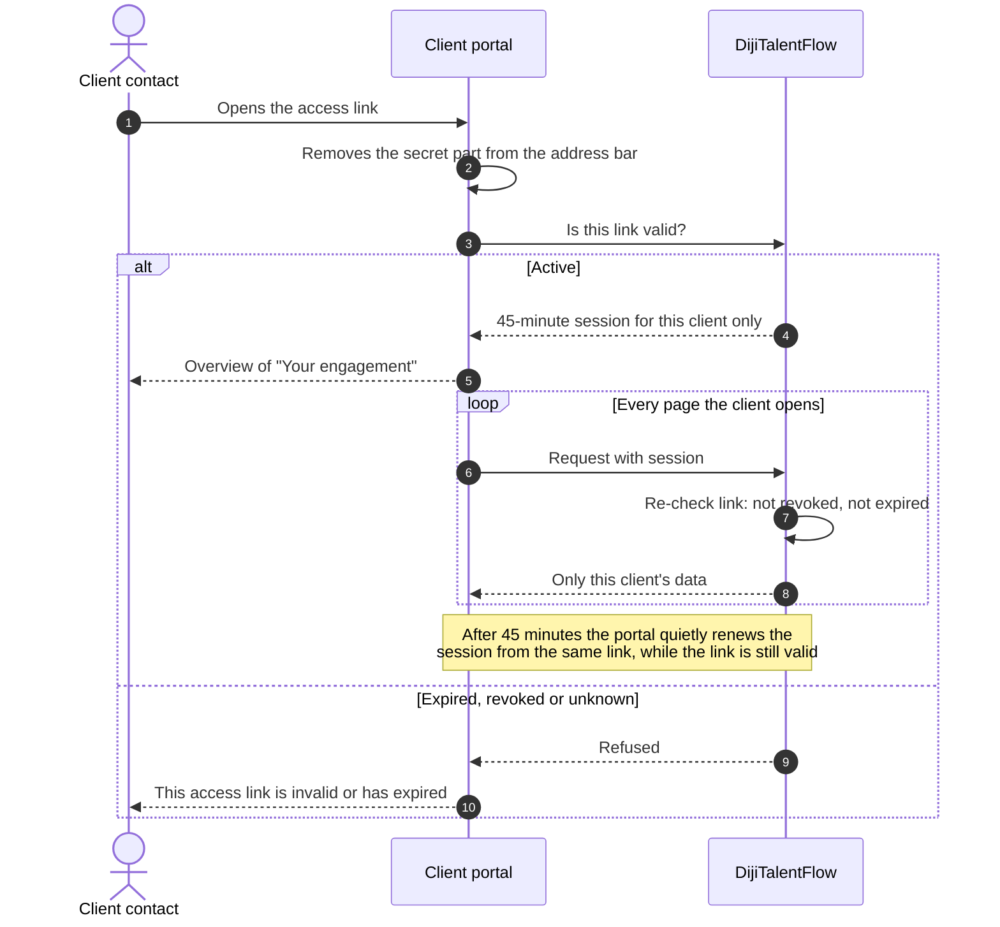
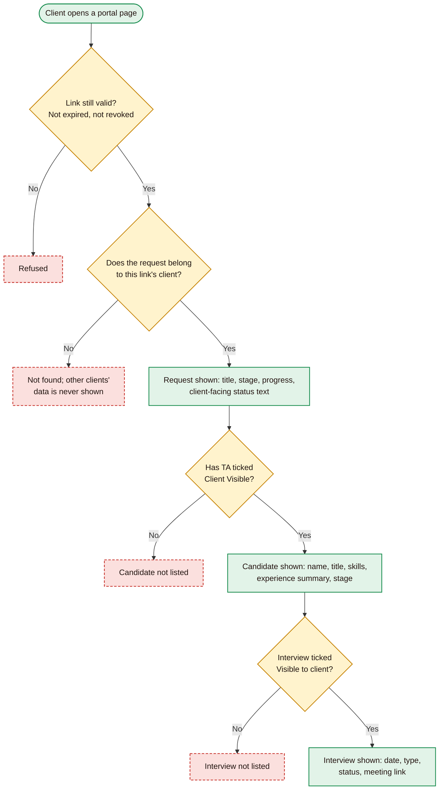
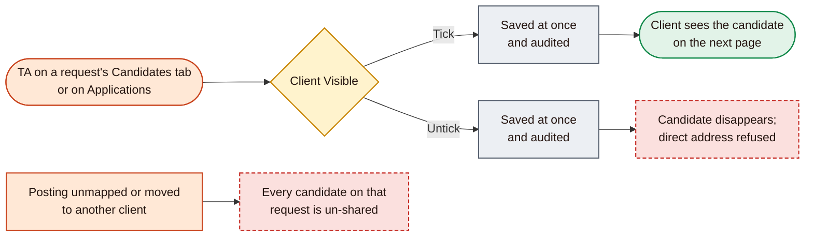

# 05: External client access and the client portal

[Start](00-START-HERE.md) · prev [04 Lever and candidate workflow](04-LEVER-AND-CANDIDATE-WORKFLOW.md) · next [06 Screen-by-screen guide](06-SCREEN-BY-SCREEN-GUIDE.md)

Clients have **no DijiOne account**. TA gives a client contact a private, time-limited **access link**. It opens a separate, read-only **Client Talent Review Workspace** (the client portal), showing only that client's requests and the candidates TA has shared. Colours follow the [legend](00-START-HERE.md#how-to-read-the-diagrams).

> Every action here is 🔑 **External access**: it changes what someone outside Dijital Team can see. Production has one active link (Access4, open item 1); do not issue, change or revoke links in Production without approval.

| Section | Diagram | Screens | UAT |
|---|---|---|---|
| [E1](#e1-access-link-lifecycle) | Access-link lifecycle | [S20](06-SCREEN-BY-SCREEN-GUIDE.md#s20-client-access-links) | [U9](07-GUIDED-WALKTHROUGH-AND-UAT.md#u9-external-access-link-management) |
| [E2](#e2-what-happens-when-the-client-opens-the-link) | Opening the link | [S22](06-SCREEN-BY-SCREEN-GUIDE.md#s22-portal-access-page)–[S28](06-SCREEN-BY-SCREEN-GUIDE.md#s28-portal-interviews) | [U10](07-GUIDED-WALKTHROUGH-AND-UAT.md#u10-client-portal-access) |
| [E3](#e3-what-the-client-can-and-cannot-see) | What the client can and cannot see | [S24](06-SCREEN-BY-SCREEN-GUIDE.md#s24-portal-overview)–[S28](06-SCREEN-BY-SCREEN-GUIDE.md#s28-portal-interviews) | [U8](07-GUIDED-WALKTHROUGH-AND-UAT.md#u8-candidate-visibility-restrictions) |
| [E4](#e4-sharing-and-withdrawing-candidates) | Sharing and withdrawing candidates | [S14](06-SCREEN-BY-SCREEN-GUIDE.md#s14-talent-request-detail), [S17](06-SCREEN-BY-SCREEN-GUIDE.md#s17-applications) | [U8](07-GUIDED-WALKTHROUGH-AND-UAT.md#u8-candidate-visibility-restrictions) |

---

## E1. Access-link lifecycle

| | |
|---|---|
| **Purpose** | Give one client contact secure, revocable, read-only access without creating an account |
| **Who uses it** | Any TA staff member, for clients in their scope |
| **How it starts** | DijiTalentFlow → **Client Access Links** |
| **Main actions** | Choose **Client** (required); **Contact name** and **Contact email** are optional and for records only. Set **Expires on** (1 to 90 days ahead; default 14). **Generate access link** 🔑, then **Copy link** and send it yourself. Per row: **Extend** (choose a new date → **Save**) 🔑, **Regenerate** 🔑, **Revoke** 🔑 |
| **Decision points** | How long should the client have access? Should an existing link be extended, replaced or revoked? |
| **Expected outcome** | The table shows the link with status **Active**, its expiry date ("in N days", amber at 3 days or fewer), when it was first redeemed, when it was last used, and how many times it has been used |
| **Restrictions and errors** | **The full link is shown only once.** You can re-copy it until you leave the browser session; after that the server cannot show it again, so use **Regenerate** for a new one. A link can be reused until it expires or is revoked; it is not single-use. **Revoke** acts immediately, with no confirmation. A revoked link cannot be extended; regenerate it. An expired link *can* be extended, which re-activates the same link. Expiry can never be indefinite |
| **Screens** | [S20 Client Access Links](06-SCREEN-BY-SCREEN-GUIDE.md#s20-client-access-links) |

---

## E2. What happens when the client opens the link

| | |
|---|---|
| **Purpose** | Let the client in safely, and shut them out the moment the link stops being valid |
| **Who uses it** | The client contact |
| **How it starts** | Clicking the link, whose address ends in `/access#…` |
| **Main actions** | None: the portal opens automatically ("Opening your workspace…") |
| **Expected outcome** | The **Overview** page, titled "Your engagement — *Client name*" |
| **Restrictions and errors** | Invalid, expired or revoked links show *"This access link is invalid or has expired. Ask your Dijital Team contact to send you a new link."* The session belongs to **that browser tab**: a new tab or window shows "Use the access link your Dijital Team contact sent you…" until the link is opened again. **Sign out** ends the session in that tab. Each opening and renewal adds to the link's **Uses** count. Repeated attempts are rate-limited |
| **Screens** | [S22 Access page](06-SCREEN-BY-SCREEN-GUIDE.md#s22-portal-access-page) · [S23 No session](06-SCREEN-BY-SCREEN-GUIDE.md#s23-portal-no-session-page) · [S24 Overview](06-SCREEN-BY-SCREEN-GUIDE.md#s24-portal-overview) |

---

## E3. What the client can and cannot see

| | |
|---|---|
| **Purpose** | Guarantee that a client sees only curated information about its own roles |
| **Portal pages** | **Overview**: Active requests, Candidates in process, Interviews this week, Offers in progress, and "Your requests". **Requests**: the list. **Request detail**: stage timeline, progress, and "Candidates shared with you (N)". **Candidate**: profile, read only. **Interviews** |
| **Never shown** | Hidden candidates; email, phone, location and source; internal notes, scores, TA and Customer Success status, priority; messages and documents; Lever tags and posting matches; other clients' data |
| **Interaction** | **None in V1.** The client cannot comment, approve, reject, request interviews, message or upload. Feedback happens outside DijiOne |
| **Restrictions and errors** | A candidate who is un-shared, or whose link stops working, shows "Candidate not found: this candidate is no longer shared with you, or the link is no longer valid" |
| **Screens** | [S24](06-SCREEN-BY-SCREEN-GUIDE.md#s24-portal-overview) · [S25](06-SCREEN-BY-SCREEN-GUIDE.md#s25-portal-requests) · [S26](06-SCREEN-BY-SCREEN-GUIDE.md#s26-portal-request-detail) · [S27](06-SCREEN-BY-SCREEN-GUIDE.md#s27-portal-candidate-review) · [S28](06-SCREEN-BY-SCREEN-GUIDE.md#s28-portal-interviews) |

---

## E4. Sharing and withdrawing candidates

| | |
|---|---|
| **Purpose** | TA decides, candidate by candidate, what each client sees |
| **Who uses it** | TA staff, for clients in scope |
| **Main actions** | Tick or untick **Client Visible** 🔑 |
| **Expected outcome** | The change applies from the client's next page load. Every new candidate from Lever starts hidden |
| **Restrictions and errors** | No confirmation step. A failed save flips the box back and shows "Candidate sharing could not be updated". Un-matching or moving a posting un-shares everything on its request |
| **Screens** | [S14 Candidates tab](06-SCREEN-BY-SCREEN-GUIDE.md#s14-talent-request-detail) · [S17 Applications](06-SCREEN-BY-SCREEN-GUIDE.md#s17-applications) |

Continue with [06 Screen-by-screen guide](06-SCREEN-BY-SCREEN-GUIDE.md).
