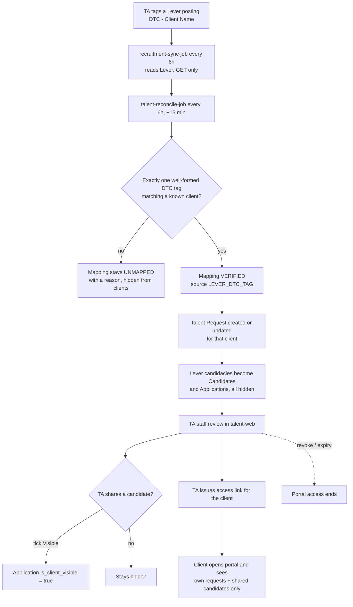
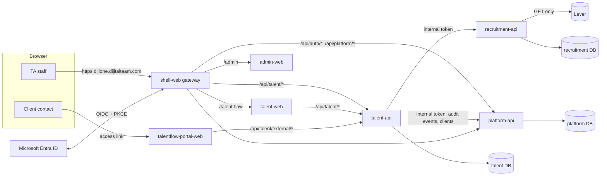
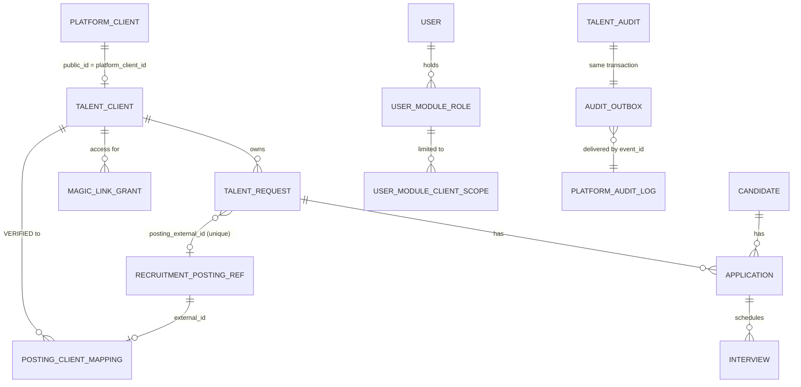
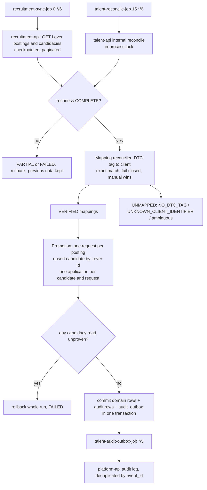

# 02: Application and architecture

[Start](00-START-HERE.md) · prev [01 Baseline](01-CURRENT-BASELINE.md) · next [03 Mac setup](03-MAC-ENVIRONMENT-SETUP.md)

This file covers the business workflows, the services and their source files, the data model and integrations, and security. All four diagrams match the code on `release/onsite-v1`.

## A. Business functionality

**Background reading:** `docs/talent-flow/requirements.md` and `workflows.md`. The V1 behaviour agreed with the owner is in `docs/talent-flow/v1-traceability.md` and `authorization-review.md`.

### The problem

Dijital Team recruits contractors for client companies, and runs that recruitment in **Lever**. Clients rarely see progress between updates. TalentFlow:
- gives TA staff one cross-client view;
- gives each client a curated, read-only window onto its own roles and the candidates TA chooses to share.

### End-to-end flow (as implemented in V1)



### Roles and what they do

| Actor | How they get access | What they can do |
|---|---|---|
| Platform admin | `PLATFORM_ADMIN` on the user | `/admin/users`: activate users, assign module roles and client scopes, create clients |
| TA_MANAGER | TalentFlow role, usually all clients | Everything TA_MEMBER can do, plus review requests and manage postings and mappings |
| TA_MEMBER | TalentFlow role with all clients or a restricted client list | Dashboard, requests, candidates, applications (stage, status, score, visibility), interviews, access links, all within scope |
| CUSTOMER_SUCCESS | TalentFlow role | Request review permission (`talent.requests.review`). The CS approval queue is effectively empty because promoted requests are auto-approved |
| Client contact | **No DijiOne account.** Receives an access link | Read-only portal for one client |

### Workflow details

**Sign-in and activation**
- A staff member signs in with Microsoft. On first sign-in an **inactive** user row is created and the login is refused.
- An admin then activates the user and assigns roles in `/admin/users`.

**Client identification**
- Only the governed Lever posting tag `DTC - <Client Name>` identifies a client. The match is exact (case-insensitive `DTC`, trimmed); there is no fuzzy matching.
- Missing, malformed, multiple or unknown tags fail closed.
- A client row is never created from a tag.
- A manual mapping wins over a tag; a conflict is flagged.

**Mapping maintenance**
- On `/talent-flow/postings`, TA can verify, unmap or reopen a mapping.
- Removing or breaking a DTC tag reverts a DTC-sourced mapping to unmapped.

**Talent Requests**
- Created **only** by promoting verified postings during reconcile. Manual creation is retired: `POST /api/talent/requests` always returns 403.
- TA can update the stage and TA status. Clients see `client_safe_status_text`.

**Candidates and applications**
- Created **only** from Lever candidacies. Manual creation is retired: `POST /api/talent/candidates` returns 403.
- There is one candidate record per Lever candidate, with many applications. See the deduplication rules in [section C](#c-data-lever-and-reconciliation).
- TA updates stage, status, score and visibility.

**Visibility and sharing**
- Every application starts hidden (`is_client_visible = false`).
- TA ticks **Visible** per application on the request's Candidates tab, or in Applications.

**Access links**
- Issued at `/talent-flow/access-links` for one client (`CLIENT_WORKSPACE` scope). The default lifetime is 14 days, within a 1–90 day range.
- Email is in mock mode in every environment, so TA copies the link from the screen. It is shown once.
- Links can be extended, regenerated and revoked.

**Portal**
- The client opens the link and redeems it, receiving a 45-minute session.
- The portal shows the dashboard, the client's requests, the shared candidates (client-safe fields only) and interviews.
- Messages and documents are not in V1.

**Interviews**
- TA can schedule interviews and change their status.
- The portal shows only interviews whose candidate is shared.

**Messages and documents**
- Staff-side only. Documents store metadata only: there is no file storage (`local://` placeholder).

**Audit**
- Every important action writes a Talent audit row and an outbox row in the same transaction.
- `talent-audit-outbox-job` delivers them to platform-api's central audit log every 5 minutes. Delivery is idempotent through `event_id`.

### Implemented, retired, future

| Implemented (V1) | Retired or disabled (kept in code) | Future / not in V1 |
|---|---|---|
| DTC mapping, promotion, scheduled sync and reconcile | Client-submitted talent requests (403) | Client feedback in the portal |
| Visibility control, access links, portal | Manual candidate creation (403) | Real document storage |
| Interviews, messages and documents (metadata) for staff | Lever webhooks (handler present, not registered) | Automatic stage progression from Lever |
| Audit outbox to central audit log | HubSpot (`commercial-api` stub only) | Alerting, CI-driven deployment |
| Sync status and "Sync now" (5 s timeout to recruitment-api) | | Branded portal domain, Module Admin (`local/talent-module-admin`, unpushed) |

## B. Technical architecture

**Read these first:** `docs/platform/service-architecture.md`, `docs/platform/service-contracts.md`, `docs/platform/data-ownership.md`, `docs/platform/deployment-topology.md`.

**A warning about `CLAUDE.md`:** its early sections describe a modular monolith. Its later "Data Ownership" section overrides them. The real system is a set of separate services behind one gateway, each owning its own database.

### Services involved in TalentFlow

| Service | Path | Stack | Local port | Azure ingress | Owns |
|---|---|---|---|---|---|
| shell-web | `apps/shell-web` | Next.js 16.3, React 19.2, TypeScript | 3000 | **external** (custom domain) | Gateway: sign-in pages, Entra callback, path rewrites to every module (`next.config.ts`) |
| talent-web | `apps/talent-web` (`basePath: /talent-flow`) | Next.js | 3002 | internal | TA staff UI |
| talentflow-portal-web | `apps/talentflow-portal-web` | Next.js | 3100 | **external** | External client portal (read-only) |
| admin-web | `apps/admin-web` | Next.js | 3001 | internal | Users, roles, client scopes (`/admin`) |
| platform-api | `apps/platform-api` | Python 3.12, FastAPI, SQLAlchemy 2, Alembic, Pydantic 2 | 8000 | internal | Identity, Entra login, roles and permissions, canonical **clients**, modules, notifications, central audit log |
| talent-api | `apps/talent-api` | same | 8002 | internal | TalentFlow domain: requests, candidates, applications, posting mappings, access grants, audit outbox |
| recruitment-api | `apps/recruitment-api` | same | 8005 | internal | **Only Lever client.** Postings, candidacies, sync runs, DTC tag parsing |

**Shared packages:**
- `packages/auth-client-py`: JWT verification and the `require_internal_service` dependency used by every backend.
- `packages/auth-client-ts`, `packages/design-system`, `packages/contracts`.

**Not part of TalentFlow, but deployed in the same environments:** admin-api, birthday-*, people-api, onsite-*, atwork-*, commercial-api (a stub) and spark-api.



### talent-api map (`apps/talent-api/app`)

| Area | Files |
|---|---|
| Routes | `api/routes/talent_requests.py`, `talent_candidates.py`, `talent_applications.py`, `talent_postings.py`, `talent_clients.py`, `talent_dashboard.py`, `talent_interviews.py`, `talent_messages.py`, `talent_documents.py`, `talent_external.py` (portal), `talent_external_admin.py` (link admin), `recruitment.py` (sync status, ad-hoc sync, internal reconcile), `talent_summary.py`, `health.py` |
| Authorization | `api/deps.py`: `get_talent_scope`, `require_staff_scope`, `get_talent_external_scope` |
| Reconcile | `services/posting_client_mapping_reconciler.py` (DTC → mapping), `services/verified_posting_promotion_reconciler.py` (mapping → request, candidate, application; batched), `services/recruitment_consumer_service.py` (client for recruitment-api; 5 s interactive, 90 s batch timeouts) |
| Access links | `services/magic_link_service.py`, `services/client_access_service.py`, `models/magic_link_grant.py`, `core/rate_limit.py` |
| Audit | `services/audit_service.py`, `services/audit_outbox_service.py`, `scripts/drain_audit_outbox.py` (job entrypoint) |
| Scripts | `scripts/seed.py` (client bootstrap; local `--reset` only), `scripts/drain_audit_outbox.py` |
| Config | `core/config.py`, `.env.example` (variable names only) |
| Tests | `tests/`, roughly 30 files. See [05 Operations](05-OPERATIONS-AND-OPEN-ITEMS.md) |

### recruitment-api map (`apps/recruitment-api/app`)

| Area | Files |
|---|---|
| Lever | `integrations/lever/live_client.py` (GET only), `mock_client.py`, `mapper.py`, `integrations/factory.py` |
| Sync | `services/recruitment_sync_service.py`, `lever_posting_service.py`, `lever_candidacy_sync_service.py`, `scripts/run_scheduled_sync.py` (job entrypoint) |
| DTC parser | `recruitment_source/dtc.py` |
| Models | `models/posting.py`, `recruitment_candidacy.py`, `recruitment_candidate.py`, `sync_run.py`, `external_mapping.py`, `integration_event.py` |
| Routes | `api/routes/recruitment.py` (internal), `webhooks.py` (not registered with Lever), `health.py` |

### platform-api (TalentFlow-relevant)

| Area | Files |
|---|---|
| Entra | `services/entra_service.py`: users created inactive, internal-employee detection, no linking accounts by email alone |
| Authorization | `services/authorization_service.py`, `core/permissions.py` (role → permission catalogue) |
| Admin | `api/routes/platform_admin.py`: activate users, platform role, module role and scope, create clients |
| Models | `models/user.py` (`users`, `user_module_roles`), `user_module_client_scope.py`, `client.py`, `module.py`, `audit_log.py` |

### Service-to-service communication

- **Internal calls** carry the header `X-Internal-Token: <INTERNAL_SERVICE_SECRET>`, checked by `packages/auth-client-py` (`make_verify_internal_request`). `X-Internal-Caller` is sent for logging only.
- **Inside Azure**, services address each other by app name over the environment's internal network (`http://platform-api`, `http://recruitment-api`, `http://talent-api`). Every API has internal ingress only.
- **Staff calls** carry a DijiOne HS256 JWT signed with `PLATFORM_JWT_SECRET`. It is issued by platform-api after Entra sign-in and holds role, permission and client-scope claims.
- **Portal calls** use a separate short-lived session JWT signed with `EXTERNAL_SESSION_JWT_SECRET`, issued on link redemption. See [section D](#d-security-and-access).

### Azure

| Resource | DEV | UAT | Production |
|---|---|---|---|
| Container Apps environment | `cae-dijione-dev` | `cae-dijione-uat` | `cae-dijione-prod` |
| Registry | `crdijionenonprod` (shared by DEV and UAT) | | `crdijioneprod` |
| PostgreSQL Flexible Server | `psql-dijione-dev` (**UNVERIFIED** name) | `psql-dijione-uat` (B1ms, 7-day point-in-time recovery) | `psql-dijione-prod` (14-day point-in-time recovery) |
| Key Vault | `kv-dijione-dev` | `kv-dijione-uat` | `kv-dijione-prod` |
| User-assigned identity | `id-dijione-dev` | `id-dijione-uat` | `id-dijione-prod` |
| Logs | Log Analytics: `ContainerAppConsoleLogs_CL` | | |

**Secrets** are Key Vault references through the managed identity. Names only:
- `database-url-platform`, `database-url-talent`, `database-url-recruitment`;
- `internal-service-secret`, `external-session-jwt-secret`, `jwt-<env>-secret`;
- `entra-client-secret-<env>`, `lever-api-key-<env>`.

Never read or print their values.

**Container Apps Jobs (TalentFlow):**

| Job | Trigger | Command | Notes |
|---|---|---|---|
| `recruitment-sync-job` | `0 */6 * * *` | `python scripts/run_scheduled_sync.py` (recruitment-api image) | DEV still runs the older `curl` form. **UNVERIFIED**: check the job args |
| `talent-reconcile-job` | `15 */6 * * *` | `curl -fsS -X POST … http://talent-api/api/talent/internal/recruitment/reconcile` | Old talent-api image `ad577613`, used only for `curl`. 900 s timeout, 1 retry |
| `talent-audit-outbox-job` | `*/5 * * * *` | `python -m scripts.drain_audit_outbox` | 0.25 vCPU / 0.5 GiB, 280 s, no retries |
| `migrate-*-api` | Manual | `alembic upgrade head` | Its image must be set to the release image before a migration runs |
| `bootstrap-talent-clients` | Manual | `python scripts/seed.py` (no `--reset`) | Gets or creates Talent client rows from Platform clients |

**Infrastructure as code:** `deploy/bicep/main.bicep` and its parameter files. **Do not run a full `main.bicep` deployment.** It resets custom domains and ad hoc settings; see `deploy/README.md`. Releases are targeted, per resource (see [05 Operations](05-OPERATIONS-AND-OPEN-ITEMS.md)).

### CI

`.github/workflows/`: `api.yml`, `web.yml`, `postgres.yml`, `migrations.yml`, `module-boundaries.yml`, `secret-scan.yml`.
- **Triggers:** pull requests, and pushes to `main`.
- **CI does not deploy.**
- **Python version:** read from `.python-version` (3.12). Node is 20 (`.nvmrc`).
- **Known exception:** six Birthday test failures are accepted as unrelated to TalentFlow.

## C. Data, Lever and reconciliation

**Reference:** `docs/platform/data-ownership.md`, `docs/platform/recruitment-source.md`, `docs/talent-flow/data-model.md`.

### Ownership

| Database (PostgreSQL in Azure, SQLite locally) | Owner | Key tables |
|---|---|---|
| platform | platform-api | `users`, `user_module_roles`, `user_module_client_scopes`, `clients` (canonical: `public_id`, `name`, `status`), `client_external_ids`, `application_modules`, `audit_logs` (`event_id` unique), notifications |
| recruitment | recruitment-api | postings (with tags), candidacies, candidates (Lever ids), `sync_runs`, sync checkpoints, external mappings, integration events |
| talent | talent-api | `clients` (extension keyed on `platform_client_id`), `recruitment_posting_refs`, `posting_client_mappings`, `talent_requests`, `candidates`, `applications`, `interviews`, `messages`, `documents`, `magic_link_grants`, audit, `audit_outbox` |

**Rules:**
- No cross-database joins or access. Services talk only over internal HTTP.
- Integer IDs are never assumed to match across databases. The cross-references are `platform_client_id` (= the Platform `clients.public_id`, such as `cli-access4`) and the Lever ids.



### Lever and the Recruitment Source

**Who talks to Lever**
- Only `recruitment-api` talks to Lever, and only with GET. A static guard test in talent-api forbids any direct Lever import (`tests/test_no_direct_lever_dependency.py`).
- Lever webhooks are not registered.

**What the sync stores**
- `recruitment-sync-job` stores postings and their candidacies.
- It is checkpointed and paginated (migration `0003_sync_checkpoints`).
- It reports a freshness state; reconcile proceeds only when that state is `COMPLETE`.

**Identifiers**

| Identifier | Field |
|---|---|
| Posting | `external_id` on `recruitment_posting_refs`, `posting_external_id` on mappings and requests |
| Candidate | `candidates.lever_external_id` (unique where not null) |
| Opportunity / candidacy | Stored on applications |

### Reconcile (talent-api)

Triggered by `POST /api/talent/internal/recruitment/reconcile` with the internal token. In V1 this runs synchronously and reports its outcome:

| Outcome | HTTP | Meaning |
|---|---|---|
| `SUCCEEDED` | 200 | Postings and candidacies fully processed |
| `PARTIAL` | 200 | Candidacies unavailable, a limit was hit, or no postings were returned. Logged as a warning |
| `SKIPPED` | 409 | Another reconcile is already running (in-process lock) |
| `FAILED` | 503 | Source unavailable or an unexpected error. Everything is rolled back |

**Order of work:**
1. **Posting refresh:** refreshes `recruitment_posting_refs` from recruitment-api.
2. **Mapping reconciler** (`posting_client_mapping_reconciler.py`): applies the DTC rules.
   - Statuses: `UNMAPPED` / `VERIFIED`.
   - Resolution reasons: `RESOLVED`, `NO_DTC_TAG`, `UNKNOWN_CLIENT_IDENTIFIER`, ambiguous, malformed, and `CONFLICT_MANUAL_OVERRIDE`.
3. **Promotion reconciler** (`verified_posting_promotion_reconciler.py`), for each VERIFIED posting:
   - creates or updates exactly one Talent Request (enforced by a unique `posting_external_id`);
   - upserts candidates by Lever candidate id;
   - creates or updates applications.
   - **Deduplication:** one application per (candidate, request). Duplicate candidacies collapse (`collapsed_duplicate_candidacies`).
   - **Performance:** lookups are batched (`map_by_lever_external_ids`, `map_for_requests`), about 489 SQL round trips per full run. A full reconcile takes 37–46 s against a 220 s budget. Regression test: `tests/test_reconcile_pagination.py::test_promotion_lookups_do_not_grow_with_candidacies`.
   - **Fail-closed:** if any candidacy read for a verified posting is unproven, the whole run rolls back.
   - **Withdrawal:** requests whose mapping is lost have client access withdrawn (`requests_access_withdrawn`), and visibility is cleared.

**Production integrity gates passed on 12 Nov:**
- 0 duplicate candidate/request pairs;
- 0 duplicate Lever opportunities and 0 duplicate Lever candidates;
- 0 cross-client requests;
- 0 applications on unverified postings;
- at most 1 request per posting;
- client, grant and visibility hashes unchanged.

### Visibility and grants

**Visibility**
- `applications.is_client_visible` defaults to false.
- Portal queries require the request's client to equal the session's client, **and** the application to be visible.
- Interviews also require the application to be visible.

**Access grants (`magic_link_grants`)**
- Stored fields: `public_id`, `client_id`, `scope_type=CLIENT_WORKSPACE`, `token_hash` (SHA-256 of a random token; the raw token is never stored), `token_prefix`, `expires_at`, `redeemed_at`, `use_count`, `revoked_at`/`revoked_by_user_id`, and the contact name and email.
- **Validity:** a grant is valid if not revoked and `now < expires_at`. This is re-checked on every portal request.
- **Extend:** moves `expires_at` on the same row. A revoked grant cannot be extended.
- **Regenerate:** issues a new token.

### Audit outbox

1. A Talent write commits its domain row, the Talent audit row and an `audit_outbox` row (`PENDING`) in one transaction (migration `c4d6e8f0a2b3`).
2. `scripts/drain_audit_outbox.py` claims batches and posts them to platform-api with an `event_id`. Platform deduplicates on `uq_audit_logs_event_id`.
3. Rows are marked `DELIVERED`. Claims that fail are released for retry.

**Current state:** every environment shows all rows `DELIVERED` and 0 pending (13 Nov).

### Migrations

| Service | Location | Head in all three environments (13 Nov) |
|---|---|---|
| platform | `apps/platform-api/alembic/versions` | `e1f3a5b7c9d0` (`activate_atwork_uat_prod`, added by #94 after V1's `c9d2e4f6a8b1`) |
| talent | `apps/talent-api/alembic/versions` | `c4d6e8f0a2b3` (audit_outbox) |
| recruitment | `apps/recruitment-api/alembic/versions` | `0003_sync_checkpoints` |

**Strategy:**
- Migrations only add things. They run forward with `alembic upgrade head` through each environment's `migrate-*-api` job, before the matching API image is deployed. The order is Platform, then Recruitment, then Talent.
- Some older migrations are deliberately irreversible, so roll back by image, not by downgrade.
- CI validates migrations on PostgreSQL (`postgres.yml`, `migrations.yml`).

### Reconciliation flow



## D. Security and access

**Reference:** `docs/platform/authentication.md`, `authorization.md`, `effective-access.md`, `docs/talent-flow/authorization-review.md`.

### Staff authentication (Microsoft Entra)

**Sign-in flow**
- Authorization Code with PKCE. Each environment has its own single-tenant app registration: `dijione-dev`, `dijione-uat`, `dijione-prod`.
- `shell-web` sends the browser to Entra. The callback is `apps/shell-web/src/app/api/auth/callback/route.ts`.
- platform-api (`/api/auth/entra/token`) validates the id_token: RS256 against Entra's published keys, plus audience, issuer, expiry, tenant and nonce.
- platform-api then issues a DijiOne JWT (HS256), stored in `localStorage` as `dijione.devToken`.

**V1 fix:** the callback escapes `<`, `>`, `&` and the U+2028/U+2029 characters in inline script (`scriptJson`). It only returns users to same-origin paths. This closed a reflected XSS, and Production now renders a crafted error as plain text.

**Accounts** (`entra_service.resolve_entra_user`)
- New users are created **inactive** and refused until an admin activates them.
- An email claim alone never links an existing account (#86). Linking requires proven tenant membership: tenant id, issuer, the `acct=0` claim, and no `#ext#` guest marker.
- `internal_employee` is computed at each login.

**Dev identity:** passwordless dev identity exists for local use only. Hosted environments use `AUTH_MODE=entra`. **UNVERIFIED:** whether DEV still allows dev identity (`DEV_IDENTITY_MODE`).

### Authorization

**Roles and permissions**
- Roles live in the platform database, per module: `user_module_roles`, with client scopes in `user_module_client_scopes` (`all_clients` or `client_ref`).
- The permission catalogue is `apps/platform-api/app/core/permissions.py`.
- TA_MEMBER, CUSTOMER_SUCCESS and TA_MANAGER share the staff permissions. CS and Manager add `talent.requests.review`. No role has `talent.requests.create` or `talent.candidates.create`.
- Claims are placed in the DijiOne JWT. Every talent-api query is then filtered by the caller's resolved client ids (`api/deps.py`, `get_talent_scope` and `require_staff_scope`). **Hiding something in the frontend is not treated as authorization.**

**Audit P0-6 is closed (verified in code):** a TALENT_CLIENT persona with no assigned client gets 403 ("User has no client assigned for DijiTalentFlow", `apps/talent-api/app/api/deps.py`). A staff `client_ids` of `None` still means all clients, as intended.

Restricted portfolio users see only their scoped clients, across lists, details, edited IDs, search, postings actions and access-link issuing.

### Service-to-service

- `X-Internal-Token` holds the shared `INTERNAL_SERVICE_SECRET`, checked by `packages/auth-client-py`.
- Internal routes refuse anonymous callers. In Production, `POST /api/talent/internal/recruitment/reconcile` through the gateway returns 401.
- The intended future model is managed identity or signed service tokens. It is not built.

### External client access

**Issue** (`POST /api/talent/external/grants`, staff and in scope)
- A random URL-safe token is generated and only its SHA-256 hash is stored.
- The link is `${EXTERNAL_PORTAL_BASE_URL}/access?...` and is shown once.
- Lifetime: 14 days by default, within 1–90 days.

**Redeem** (`POST /api/talent/external/redeem`)
- Rate limited per source IP and globally (`core/rate_limit.py`), with near-constant response timing.
- A valid grant returns a session JWT:

| Property | Value |
|---|---|
| Signing secret | `EXTERNAL_SESSION_JWT_SECRET` (separate from the staff secret) |
| Issuer | `dijitalent-external` |
| Lifetime | 45 minutes |

**Each portal request** re-checks that the grant is not revoked and not expired. Revoking or expiry ends access at the next request.

**Admin** (`/api/talent/external/grants/{public_id}/revoke|extend|regenerate`): every action is audited.

**What clients can see**
- Only the session client's requests, through client-safe DTOs.
- Only visible applications, and only interviews for visible applications.

**Known follow-up (audit P2-8, confirmed in code):** the redeem limiter and the audit IP tag both key on `request.client.host` (`talent_external.py`). Behind the Container Apps ingress this is likely the proxy's address, so every client shares one per-IP budget. That fails safe (it is stricter), but under load it could throttle legitimate users. The fix belongs in the backlog ([05 Operations](05-OPERATIONS-AND-OPEN-ITEMS.md#open-items)): use a trusted forwarded-for header.

### Security tests (talent-api `tests/`)

| Area | Files |
|---|---|
| Tenant isolation | `test_tenant_isolation.py`, `test_client_scope_resolution.py`, `test_portfolio_scope_mutations.py` |
| External access | `test_external_access.py`, `test_external_candidate_review.py`, `test_external_grant_admin.py`, `test_grant_expiry_extend.py`, `test_magic_link_grant_model.py`, `test_magic_link_grant_migration_shape.py` |
| Lever boundary | `test_no_direct_lever_dependency.py` |

Platform-api tests cover auth, roles, scopes and Entra; run them with `-k "auth or role or scope or entra or permission"`.

**Last local run (12 Nov, SQLite):** 119 Talent tests and 63 Platform tests passed.

### Live acceptance status

| Scenario | Automated | Live-user tested |
|---|---|---|
| Staff sign-in by role; a user with no role is refused | yes | **no** (only the admin account signed in) |
| Restricted portfolio isolation | yes | **no** |
| Candidates hidden by default | yes | **yes**: 0 visible in every environment |
| Sharing a candidate shows it in the portal | yes | **no** |
| Issue, redeem and revoke a link | yes | **partly unknown.** A Production link for Access4 was issued and redeemed once on 13 Nov, outside the agreed test plan (see [05 Operations](05-OPERATIONS-AND-OPEN-ITEMS.md#open-items)) |
| Invalid, forged or anonymous access refused | yes | **yes**: 401 in UAT and Production |

The UAT script for live checks is in `docs/talent-flow/v1-uat-checklist.md`. Testers T1 (TA_MEMBER, all clients) and T2 (TA_MEMBER, Axiom IT only) were approved by the owner but never activated.

### Authentication and authorization flow

```mermaid
sequenceDiagram
  autonumber
  participant U as Staff browser
  participant SW as shell-web
  participant E as Microsoft Entra ID
  participant PA as platform-api
  participant TA as talent-api
  U->>SW: Sign in with Microsoft
  SW->>E: Authorization Code + PKCE
  E-->>SW: /api/auth/callback?code&state
  SW->>PA: POST /api/auth/entra/token (code, state, flow cookie)
  PA->>PA: validate id_token, resolve user
  alt new or inactive user
    PA-->>SW: refused (created inactive; admin must activate in /admin/users)
  else active user
    PA-->>SW: DijiOne JWT (roles, permissions, client scopes)
  end
  U->>TA: /api/talent/* with Bearer JWT
  TA->>TA: get_talent_scope: filter every query by allowed client ids
  Note over U,TA: Client contacts never get a JWT from Entra.<br/>A magic link is redeemed at /api/talent/external/redeem for a 45-minute external session,<br/>re-checked against grant revoked_at/expires_at on every request.
```
