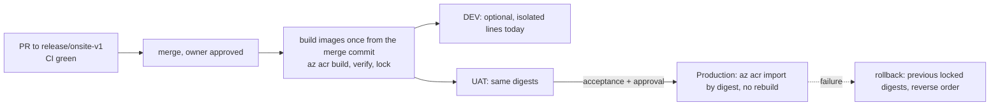

# 04: Git and migration plan

[Start](00-START-HERE.md) · prev [03](03-MAC-ENVIRONMENT-SETUP.md) · next [05 Operations](05-OPERATIONS-AND-OPEN-ITEMS.md)

**The rule:** GitHub (`origin`) is the only meeting point between the two machines. A copied folder or a single `git pull` does not prove the copies are in sync; compare commit hashes. **Every push, merge, branch deletion, deployment or cloud change needs the owner's explicit approval at the time.**

## Branches

| Branch | Role |
|---|---|
| `release/onsite-v1` | **Integration and release line.** All recent releases (TalentFlow V1 #92, AtWork #94–#96) merged here by PR. New TalentFlow work branches from it |
| `main` | Stale (`e21fdb2`, 3 Sep). CI's push trigger is on `main`; PR checks run on any PR. Merging the release line back to `main` is an open item |
| `release/talentflow-v1`, `feat/talent-audit-outbox`, `fix/talent-*` | Merged or superseded V1 work; keep for history |
| `docs/talentflow-v1-release` | PR #93, draft, the release record |
| `docs/talentflow-handover` | This package (local only until approved) |

**Branch protection:** not available on the current GitHub plan, so it is enforced by discipline. Follow `docs/platform/engineering-gatekeeper.md`. **Known accepted CI exception:** six unrelated Birthday test failures.

## Step-by-step: validate the Mac copy (read-only)

```bash
cd "/Volumes/SD_APFS/Diji Projects/DijiOne/dijione-platform"
git status -sb                         # local edits? which branch?
git stash list                         # anything parked?
git fetch --all --prune                # safe: updates remote-tracking refs only
git log --oneline -1 origin/release/onsite-v1        # expect 75a9a3d or newer
git branch -vv | grep -E "ahead|behind|gone"          # divergence report
git rev-list --left-right --count HEAD...origin/release/onsite-v1
git for-each-ref --format='%(refname:short)' refs/heads | while read b; do
  n=$(git rev-list --count "$b" --not --remotes); [ "$n" -gt 0 ] && echo "$b: $n local-only commits"; done
git diff --stat 0437a89 origin/release/onsite-v1 -- apps/talent-api apps/talent-web apps/talentflow-portal-web apps/recruitment-api
git worktree list                      # Windows paths will show as missing; do not prune yet
```

**Expected:** the Mac copy matches whatever the Windows checkout was at copy time, on `feat/onsite-dashboard-v1` with an uncommitted `deploy/README.md`. **Check this:** if `git status` shows hundreds of modified files, the copy changed line endings or file modes. Stop and report it; do not commit.

## Moving the Windows-only items (owner decides each)

1. **This handover package.** The cleanest route: the Windows agent commits it on `docs/talentflow-handover` and pushes, after approval, and the Mac runs `git fetch`. The alternative is copying the `docs/talent-flow/handover/` folder by hand.
2. **Local-only branches** worth keeping (`local/talent-module-admin`, `local/dev-env-deterministic`, `local/ui-ux-brand-verification`). Push from Windows only after approval, so the Mac can fetch them.
3. **`.env` files.** Do not move them through Git or documents. Recreate them from `.env.example`. Real keys are needed only for live-mode local work, which is not required.
4. **`.local-backups/*.db`.** Do not move them. They may contain personal data.
5. **Windows `.venv`, `node_modules`, `.next`, caches.** Never move them; rebuild on the Mac.

## Continuing development safely

```bash
git fetch origin
git switch -c feat/talent-<short-topic> origin/release/onsite-v1     # always from the fresh remote tip
# or keep the main checkout untouched:
git worktree add ../dijione-wt/<topic> -b feat/talent-<topic> origin/release/onsite-v1
```

**One branch belongs to one machine at a time.** Before switching machines:
1. Commit the work.
2. Push it, if approved.
3. Note the hash.
4. On the other machine, `git fetch`, then confirm `git rev-parse origin/<branch>` matches that hash before continuing.

**Never** run `git push --force` or `git reset --hard origin/...` over unpushed work, or delete remote branches. Rebase only your own unshared branch, and only with approval.

**Keep worktrees inside the repository** (`.worktrees/`, excluded through `.git/info/exclude`) or in a sibling folder. Never put them in other user directories.

**Pull requests:**
- **Target:** PRs go to `release/onsite-v1`.
- **Commit message:** ends with the Claude co-author line.
- **Description:** ends with the Claude Code line.
- **`gh` CLI:** if it isn't installed, give the owner the GitHub "create PR" link.
- **Merging:** the owner merges, or approves the gatekeeper to merge, after CI.
- **Versions:** web apps bump their patch version when released (`npm run versions:check -- --apps <app>`). Major bumps need approval.

## Promotion and rollback (summary; detail in [05](05-OPERATIONS-AND-OPEN-ITEMS.md))


